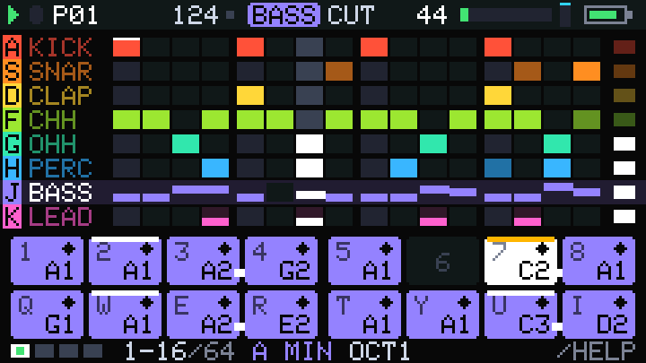
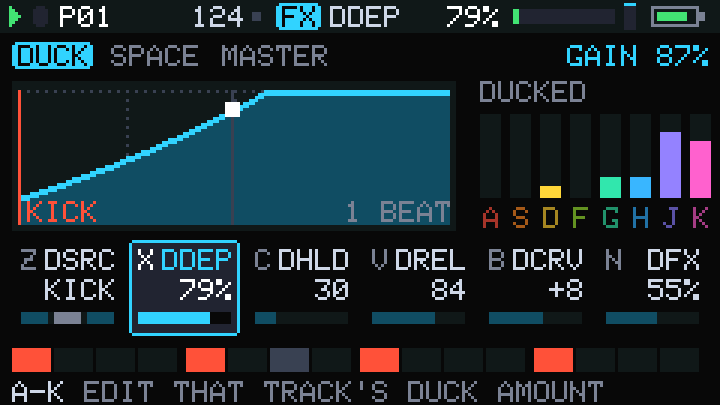

# Pocket Groove

A house and techno groovebox firmware for the M5Stack **Cardputer-Adv** (ESP32-S3, 240x135 screen, 56-key keyboard, ES8311 codec to a mono headphone jack). Eight tracks: kick, snare, clap, closed and open hat and a six-model percussion voice (all synthesised, no samples), a 303-style bass with FM and wavefolding, and a four-voice chord synth. 16 patterns of up to 64 steps, parameter locks, probability, ratchets, polymeter, a song chain, a kick-driven sidechain ducker, tempo-synced delay, reverb, a DJ filter and master drive.




The player's manual is [`docs/MANUAL.md`](docs/MANUAL.md). The rest of this page is for working on the code.

Everything in `lib/pg` is portable C++17 and runs the same on the desktop, so the instrument (sound, sequencer, UI, file format) is developed and tested on a PC; the device-specific part is a thin layer in `src/`.

## Build and flash the firmware

You need PlatformIO Core 6.2.0 or newer and `git` on the `PATH` (the M5Stack libraries are fetched from GitHub). [`docs/BRINGUP.md`](docs/BRINGUP.md) has the installation steps per OS, serial-port permissions, the download-mode procedure and how to return to the factory firmware. It walks through the `smoke` hardware test; the instrument is flashed the same way with the `cardputer-adv` environment.

Build the instrument (the default environment):

```bash
pio run -e cardputer-adv
```

Build and flash it over USB-C:

```bash
pio run -e cardputer-adv -t upload
```

Serial monitor (115200 baud; `r` prints a full report, `h` help, `m` during boot opens the boot menu; close it before using `tools/pg`):

```bash
pio device monitor -e cardputer-adv
```

The hardware smoke test (keyboard, audio, CPU, storage pages; see BRINGUP):

```bash
pio run -e smoke -t upload
```

The build also writes a merged image, `.pio/build/cardputer-adv/firmware.factory.bin`, for flashing at offset 0 without PlatformIO:

```bash
esptool --chip esp32s3 --port /dev/ttyACM0 --baud 460800 write-flash 0x0 .pio/build/cardputer-adv/firmware.factory.bin
```

A prebuilt merged image may also be in `build/firmware/pocket-groove.bin` (BRINGUP section 8). If the upload can't connect: switch the device off, hold the G0 button while plugging in USB, release it, upload again. In the cloud sandbox, `source tools/sandbox-pio-setup.sh` first (it routes PlatformIO around the blocked package registry; not needed on a normal machine).

## The instrument on your computer

`tools/pg-desktop` runs the same instrument in a window on a Mac (or Linux PC): the device's engine and UI, the Mac keyboard as the Cardputer keyboard, stereo sound, projects in `./projects` that `tools/pg push` / `pull` move to and from the device, F9 to record. It needs SDL2 (`brew install sdl2 cmake`). Key map, options and the differences from the device: [`docs/DESKTOP.md`](docs/DESKTOP.md).

```bash
tools/pg-desktop
```

## Desktop build and tests

The host build compiles every component of `lib/pg` as a static library, the tests, the system tests and the tools.

```bash
cmake -S host -B build/host
```

```bash
cmake --build build/host -j4
```

```bash
ctest --test-dir build/host
```

The `test_*_bench` tests time the DSP on the host and can fail when the machine is busy (for example under `ctest -j`); rerun them alone. Add `--output-on-failure` to see the failing checks.

## Render a demo to WAV and analyse it

`render_demo` plays a factory song through the real instrument. `--demo` 0, 1, 2 = ACIDJAM, BASSHAUS, WAREHOUS; `--mono` is the device's mono mode; without `--pattern` it renders the whole song chain once.

```bash
build/host/render_demo --demo 1 --pattern 0 --loops 2 --mono
```

That writes `build/renders/demo/demo1_p1_mono.wav`. `tools/ears.py` describes a WAV in numbers and a PNG (level, loudness, spectrum bands, clicks, timing against the 16th grid, and the sidechain dip after each kick). It needs numpy, scipy and matplotlib:

```bash
python3 -m pip install -r tools/ears_requirements.txt
```

```bash
python3 tools/ears.py build/renders/demo/demo1_p1_mono.wav --bpm 126
```

To hear what the ducker does, render the same pattern with it switched off and compare:

```bash
build/host/render_demo --demo 1 --pattern 0 --loops 2 --mono --duck-off
```

```bash
python3 tools/ears.py --compare build/renders/demo/demo1_p1_mono.wav build/renders/demo/demo1_p1_mono_duckoff.wav
```

`render_project --project FILE.pgv --mono` renders a saved project, and `ui_shot` drives the real UI from a key script and writes screenshots:

```bash
build/host/ui_shot host/ui_scripts/groove.txt build/ui/shots
```

The manual's screenshots come from `docs/manual/shots.txt`, its parameter reference from `build/host/param_reference --splice docs/MANUAL.md` (run from the repository root).

## Bouncing stems and moving projects over USB

`tools/pg` copies projects to and from the device over the USB cable and renders a song to stems for a DAW: one stereo WAV per track, the delay and reverb returns, and the full mix, all the same length from bar 1. It needs Python 3 with pyserial (the launcher uses PlatformIO's Python, `~/.platformio/penv/bin/python`, which has it) and CMake for the renderer. Run it from the repository root with the device plugged in:

```bash
tools/pg ls                       # projects on the device (flash and SD, plus the autosaved session)
tools/pg pull MYSONG              # copy MYSONG to ./projects/MYSONG.pgv
tools/pg bounce MYSONG            # pull, then render stems to ./bounces/MYSONG/
tools/pg bounce path/to/file.pgv  # render a file already on disk
tools/pg push path/to/file.pgv    # copy a project to the device (refused while playing unless --force)
```

Stems are taken after each track's level, pan, mute and sidechain duck, before the master bus; at unity gain the eight stems plus the two returns sum exactly to the pre-master mix (`itest_bounce` checks it). They are not normalised or limited; the default format is 32-bit float at 44.1 kHz (`--bits 16|24|32f`, `--sr`, `--wet-stems`, `--no-duck`, `--pattern P --loops N`, `--tail S`). The bounce renders the song as programmed and saved: live moves (filter sweeps, mutes played by hand) are not captured. Player-facing details are in the manual, chapter 15.

How it fits together: `build/host/bounce` (`host/tools/bounce.cpp`, render core in `host/common/bounce.h`) renders in one pass through a host-only stem tap in the engine (`lib/pg/src/pg/engine/stem_tap.h`, compiled only when `PG_STEM_TAP` is defined, which the host CMake does and the firmware does not, so the device build is unchanged; `itest_golden` pins the int16 output). The transfer protocol is `lib/pg/src/pg/io/xfer.h` (lines `~PGX <id> <body> <crc32>` on the same serial port as the log, chunked, acknowledged, with timeouts); `test_io_xfer` tests it on an in-memory filesystem and `test_pg_client` runs the real client `tools/pg.py` against the same code in `host/tools/xfer_sim` on a pseudo-terminal, with faults injected.

## Source tree

```
lib/pg/src/pg/          portable core (C++17, no Arduino/ESP headers)
  config.h project.h params.h voice.h engine.h platform.h
                        contract headers: sizes, the Project data model, ParamInfo,
                        the Voice interface, Engine commands/status, keys/display/files
  drums/                kick, snare, clap, hats, perc voices
  bass/                 the bass voice (osc + FM + folder + diode ladder)
  lead/                 the 4-voice lead (wavetables, chords, SVF filter)
  engine/               sequencer, command queue, mixer, ducker, delay, reverb, master bus, globals table
  instrument/           pg::Instrument: the eight voices + engine + one Project
  ui/                   all screens and key handling, drawing into an 8-bit framebuffer
  io/                   .pgv project files, session, UI settings over pg::FileSystem
  demo/                 the three factory songs (ROM)
src/platform/           ESP32-S3 layer: I2S audio + ES8311, TCA8418 keyboard, display, LittleFS/SD, system
src/app/                the instrument firmware: tasks, boot menu, volume, diagnostics overlay
src/smoke/              hardware smoke test (env:smoke)
host/                   desktop build: tests/ (unit), itests/ (system), tools/ (renderers, ui_shot,
                        param_reference, bench), common/ (UI harness, in-memory FS, WAV), ui_scripts/,
                        app/ (the desktop app pocket-groove, SDL2; docs/DESKTOP.md)
tools/                  pg + pg.py (USB transfer and stem bounce), pg-desktop (build + run the desktop app), ears.py (WAV analysis), gen/ (lookup-table
                        generator), ux_mock/ (UX mockups)
docs/                   MANUAL, UX spec, ARCHITECTURE, BRINGUP, hardware-notes; ux/ mockups; manual/ images
```

## Architecture in a page

**Portable core vs. platform layer.** `lib/pg` knows nothing about the hardware: it sees keys as `pg::KeyEvent`, draws into a `pg::Framebuffer` (240x135, 8-bit indexed), stores files through `pg::FileSystem` and renders interleaved int16 audio when asked. `src/platform` implements those for the Cardputer-Adv (I2S and the ES8311 codec, the TCA8418 keyboard controller, the LCD, LittleFS on internal flash and FAT on SD). `src/app/main.cpp` wires them together. The desktop build implements the same interfaces (`host/common`) so tests run the identical UI and engine.

**Threads and the command queue.** On the device the audio task (core 0, priority 20) renders 128-frame blocks with `Instrument::process`, paced by the blocking I2S write. The UI loop (core 1) handles keys as they arrive and redraws at about 30 fps; a keyboard task drains the controller's FIFO. The UI never touches engine state directly: it sends `Command`s (`SetStep`, `SetTrackParam`, `NoteOn`, `QueuePattern`, ...) through `Engine::post`, a lock-free single-producer single-consumer queue that the audio thread drains at the start of each quantum, and reads `Engine::status()` (atomics: playing, positions, trigger counters, peak, duck gain, a revision counter). Whole-track and whole-pattern writes (paste, undo) hand the engine a buffer with `WriteTrack`/`WritePattern` and wait for `status().writesDone`. Loading a project uses `suspend()` / `resume()`. The audio thread never blocks, allocates, locks or does I/O.

**The Project data model** (`project.h`) is one plain struct of about 70 KB in which every field is a `uint8_t`: 16 patterns x 8 tracks x 64 steps of 8 bytes (note, flags, velocity, gate, probability, chord, lock parameter, lock value), 32 parameters per track (24 sound, 8 mixer), 32 globals, 32 song slots. No padding and no endianness, so it can be copied, CRC'd and serialised as bytes, and the UI can read it while the audio thread writes it (a one-byte read is never torn). The audio thread is its only writer once running. `io/` compresses it into a `.pgv` file with a 64-byte CRC-checked header; `Engine::sanitizeProject` clamps any loaded bytes into range. Every parameter is a byte described by a `ParamInfo` (name, range, default, display format); the UI is generic over those tables.

**Mono device mode.** The ES8311 has one DAC channel. `Engine::setMonoOutput(true)` (the firmware's mode) mixes one bus, ignores pan, runs the delay and reverb in mono and asks voices for their mono sum. Host renders default to stereo; pass `--mono` to hear what the device plays.

**Float only.** The ESP32-S3 has a single-precision FPU; doubles are emulated in software and cost tens of times more. The core is written with `float` literals and functions and built with `-Wdouble-promotion -Wfloat-conversion`; no exceptions, no RTTI, no heap in the audio path.

**The quantum.** Audio is rendered in quanta of `kQuantum` = 16 frames (0.36 ms at 44.1 kHz). Commands, note events, envelope segment changes and filter coefficients update at most once per quantum; inner loops over the 16 frames stay tight. The sample rate is a runtime value: 44.1 kHz by default, 32 kHz as the fallback when CPU is short (boot menu). The CPU budget is about 55 % of one core (`docs/ARCHITECTURE.md` has the per-component allowances).

More: [`docs/ARCHITECTURE.md`](docs/ARCHITECTURE.md) (ground rules and budgets), [`docs/UX.md`](docs/UX.md) (the UI design spec), [`docs/hardware-notes.md`](docs/hardware-notes.md) (pins, codec, keyboard, flashing).

## Where to start reading

**Change a sound.** Each voice keeps its `ParamInfo` table at the top of its file (`lib/pg/src/pg/drums/kick.cpp`, `bass/bass.cpp`, `lead/lead.cpp`, ...) and maps the bytes to physical values in `updateCoefs` / `mapParams` / `applyParam`. Changing a default changes new projects, not saved ones or the demos (which set their own values in `demo/demo_*.cpp`). The render tests (`host/tests/test_<voice>_render.cpp`) write WAVs of every voice and preset for listening and for `ears.py`; `itest_demo` checks the demo songs stay inside their loudness and peak bounds. Then regenerate the manual's parameter reference.

**Add a parameter.** Append it to the voice's `ParamInfo` table (slots are contiguous from 0, at most 24, in page order: 8 per SOUND page), handle it in the mapping function, and add a line to `docs/manual/param_notes.txt`. The Project stores it by index, the UI shows it, `sanitizeProject` clamps it, p-locks work, all without further changes. Old saved projects carry 0 in a previously unused slot, so pick a mapping where 0 is harmless or migrate on load. A new global needs `params.h` (a contract header), the table in `engine/globals.cpp` and a column in `kFxPage` (`ui/ui_tables.h`).

**Add a UI view.** `ui/ui.h` (the `View` enum and state), key dispatch in `Ui::keyDown` (`ui/ui.cpp`), a `draw*` function in `ui/ui_draw.cpp` (redraws happen when `bodySignature` changes), the key-map and explain tables in `ui/ui_help.cpp`. Add behaviour tests to `host/itests/itest_ui_*.cpp` (they drive the real `Ui` with key events through `host/common/ui_harness.h`) and a screenshot script in `host/ui_scripts/`.

## Testing approach

- **Unit tests per component** (`host/tests/test_<component>_*.cpp`, each linked only against its component): DSP behaviour, tuning, aliasing, every parameter swept to its extremes with finite, bounded output, slides, LFOs, file round trips and fault injection.
- **Host renders.** Tests and tools write WAVs (`build/renders/...`); `tools/ears.py` turns them into numbers and plots (levels, LUFS, spectral balance, click detection, grid timing, duck dip) so sound can be reviewed and regressions caught without listening.
- **System tests** (`host/itests/`): the full instrument in stereo and mono at 44.1 and 32 kHz, every parameter p-locked at its extremes, the demo songs within their signed-off loudness, and the UI's behaviour driven key by key (`itest_ui_behaviour`, `itest_ui_edit`, `itest_ui_files`).
- **Screenshot comparison.** `ui_shot` renders real screens from scripts; `tools/ux_mock/ui_compare.py` diffs them pixel by pixel against the designer's mockups in `docs/ux/`.
- **Fuzzing.** `itest_ui_fuzz` (hundreds of thousands of random key events with guard bytes around the framebuffer), `itest_sanitize_fuzz` (random-byte projects through `sanitizeProject`), `itest_fuzz_long` (ten minutes of audio under random commands of every type, random bulk writes and random project loads), `test_io_fuzz` (corrupt files). They are also run in AddressSanitizer / UBSan builds, for example:

```bash
cmake -S host -B build/asan -DCMAKE_BUILD_TYPE=Debug -DCMAKE_CXX_FLAGS="-fsanitize=address,undefined -fno-omit-frame-pointer"
```

- **Benchmarks** (`test_*_bench`, `bench_instrument`) print nanoseconds per sample on the host; the device is roughly 15-25 times slower, which sets the budget.
