# Pocket Groove: player's manual

Pocket Groove turns the M5Stack Cardputer-Adv into an eight-track house and techno groovebox: six synthesised drums, a 303-style bass, a four-voice chord synth, a sidechain ducker, delay, reverb and a DJ filter. This manual covers firmware `0.1.0-fw1`. Every key combination here was checked against the code; where the device-level firmware (`src/app`) was still being finished when this was written, the text says **may change**.

Headphones first: the jack is driven straight from the codec and the firmware can't tell whether headphones are plugged in. Start with them off your ears.

**Contents**

1. [Quick start (60 seconds)](#1-quick-start-60-seconds)
2. [How it works](#2-how-it-works)
3. [The screen](#3-the-screen)
4. [Keyboard reference](#4-keyboard-reference)
5. [Programming drums](#5-programming-drums)
6. [Writing a bassline, three ways](#6-writing-a-bassline-three-ways)
7. [Chord stabs on the lead](#7-chord-stabs-on-the-lead)
8. [Sidechain ducking](#8-sidechain-ducking)
9. [Sound design recipes](#9-sound-design-recipes)
10. [Note values and parameter locks](#10-note-values-and-parameter-locks)
11. [Performance](#11-performance)
12. [Song mode](#12-song-mode)
13. [Copy, paste, undo](#13-copy-paste-undo)
14. [Projects and files](#14-projects-and-files)
15. [Bouncing stems](#15-bouncing-stems)
16. [Device matters](#16-device-matters)
17. [Known limitations of v1](#17-known-limitations-of-v1)
18. [Troubleshooting](#18-troubleshooting)
19. [Parameter reference](#19-parameter-reference)
20. [Samples: vocal chops](#20-samples-vocal-chops)

---

## 1. Quick start (60 seconds)

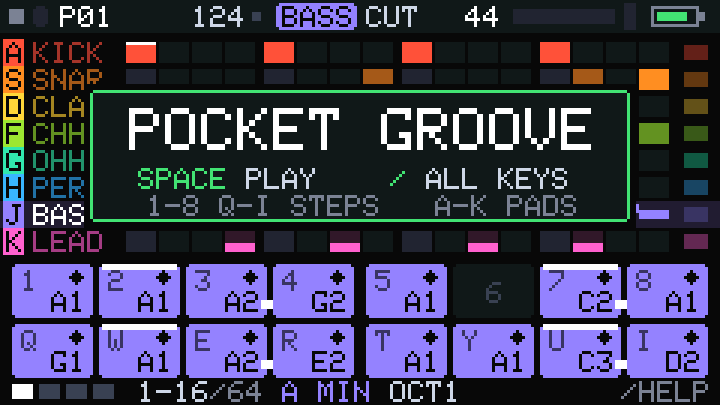

1. Plug in headphones (off your ears) and slide the power switch on the side. The first boot formats the internal flash, which takes up to 30 s; later boots take a few seconds. The factory song **ACIDJAM** is loaded and stopped, with the banner `SPACE PLAY`.
2. Press `space`. Pattern 1 plays: kick, hats, an acid line, chord stabs, and the bass and stabs pumping against the kick. Every track plays an *instrument*, and the acid line moves one of its own controls by itself: each bar it growls a little harder.
3. Set the volume: hold the **G0** button (the small button on the top edge) and tap `=` until the level is comfortable; `-` turns it down. Each tap is 2 dB.
4. Mute tracks: hold `fn`. A strip appears with the eight tracks. Tap `d` to mute the clap, `f` for the closed hats, tap again to bring them back. Release `fn`.
5. Twist the filter: hold `]` and the whole mix thins out (high-pass); hold `[` and it closes (low-pass). Press `[` and `]` together to switch the filter off.
6. Make the acid squelch: hold `=` (the bass's OPEN is what `-` `=` move at power-on; the status bar says `BASS OPEN`), then `-` to close it again. Press `9` to see the bass's instrument, ACID: hold `x` to open and `z` to close; the BITE slider under it moves by itself with the notes (its amber ◆: the notes carry it). Press `` ` `` to go back home.
7. Change pattern: hold `opt` and tap `2`. The status bar shows `P01>02`; pattern 2 starts when pattern 1 ends. The factory patterns are four bars long, so the switch can take up to about 8 s.
8. Press `space` to stop.

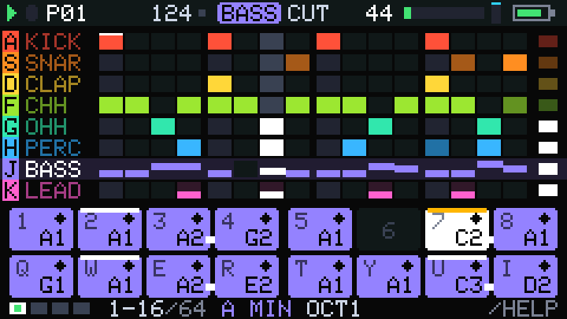

Hold `/` at any time to see what every key does in the current view. Tap `/` once for explain mode: each key you press then describes itself instead of acting (tap `/` again to leave).

---

## 2. How it works

**Eight tracks.** Each track has a key, its *pad*, on the home row:

| Pad | `a` | `s` | `d` | `f` | `g` | `h` | `j` | `k` |
|---|---|---|---|---|---|---|---|---|
| Track | KICK | SNAR (snare) | CLAP | CHH (closed hat) | OHH (open hat) | PERC | BASS | LEAD |

Pressing a pad plays the track and *selects* it. The selected track is the cursor for everything else: the step keys, the note keys, the SOUND view and the MIX strip all act on it. `shift`+pad selects without sound. (`shift` is the key labelled `Aa`.)

**Steps.** A pattern is up to 64 steps (sixteenth notes) per track, shown 16 at a time. The step keys are two rows of eight that sit under the 16 on-screen pads: `1`-`8` are steps 1-8, `q`-`i` are steps 9-16. Tap a step to switch it on or off; hold it to edit it. `'` shows the next 16 steps. There are 16 patterns per project.

**Notes.** The bottom row `z` `x` `c` `v` `b` `n` `m` `,` plays eight notes of the project scale on the selected synth track (default A minor in the demos, C minor in a new project), so you can't play a wrong note. On a drum track the same keys play the drum at eight velocities.

**Instruments.** Every track plays an *instrument*: a character with up to four *macros*, the controls that shape it (OPEN, BITE, DARK-BRIGHT ...). SOUND (`9`) is where you choose the track's instrument and move its macros (4.4). A new project and the factory demos have an instrument on every track; projects from before instruments play their *classic* sound until you pick one.

**One focused value.** `-` and `=` always change one value, the *focus*, shown in the status-bar chip (for example `BASS OPEN 42%`). You choose it in SOUND, MIX or FX; it stays on `-`/`=` when you go back home. Tap = one step, hold = sweep (it speeds up), `shift` = 8 steps at a time, `-` and `=` together = back to the default.

**Views.** GROOVE is home. Five more views each have one key that never changes: `9` SOUND, `0` MIX, `o` FX, `p` SONG, `\` PROJECT. `` ` `` always goes home. Pressing a view key while already in that view moves to its next page, row or tab.

**Held keys are layers.** Holding a key never traps you; releasing it ends the layer.

| Hold | Layer |
|---|---|
| a step key | STEP EDIT (in GROOVE) or parameter-lock mode (in SOUND, MIX, FX) |
| `fn` | mutes and solo |
| `opt` | pattern select and copy |
| `alt` | roll (stutter) |
| `tab` | tempo and swing |
| `ctrl` | edit commands: undo, cut, copy, paste, save, new |
| `/` | key map |

**Two keys at most.** No action needs more than two non-modifier keys at once; `fn`, `shift`, `ctrl`, `opt` and `alt` can be added on top. The keyboard has no anti-ghosting diodes: some combinations of three held keys make it report a fourth key you didn't press. Pocket Groove recognises these phantom keys and ignores them. When it can't tell which of two keys is the phantom (for example three pads `a` `s` `d`, or holding note `z` while pressing `opt`+`1`), it ignores both; release a key and press again. [ghosting-audit.md](ghosting-audit.md) lists every case.

**Keys that mean the same everywhere** (except while typing a file name): `space` play/stop, `` ` `` home, the five view keys, `[` `]` DJ filter, `tab` tempo, `/` help, the pads, `fn`+pad mute, `opt`+step pattern, and the `ctrl` combos.

**Edits go to the playing pattern.** When stopped, that's the pattern last played or selected with `opt`+step. To edit another pattern, select it with `opt`+step (while stopped it switches at once).

**Sound settings belong to the project,** not the pattern: changing the bass's instrument or a macro changes it in all 16 patterns. To move a macro through a pattern, give its notes their own values: the macro glides from note to note (chapter 4.4 "Motion", chapter 10).

---

## 3. The screen

**Status bar** (top line, every view):

| Item | Meaning |
|---|---|
| ▶ / ■ | Playing / stopped. |
| ● | Record: dark = off, blinking red = step-write, solid red = live record. |
| `P01` | Playing pattern. `>02` in amber, blinking = queued pattern. A chain icon and slot number in green = song mode is on. |
| `124` | Tempo. The small square next to it flashes on every beat. |
| chip | The focused value: track tag (or `FX` for globals), parameter name, value. In SONG it shows the cursor slot; in PROJECT the project name, with `*` if there are unsaved changes. |
| bar | Output level: green, amber near full scale, a red tick for 1 s after clipping. |
| thin cyan bar | Ducker gain reduction: it fills downward as the ducker pulls tracks down. |
| battery | Green above 30 %, amber above 10 %, red below; blinks below 10 %. |

**GROOVE body.** The top part shows all eight tracks, 16 steps each. The selected track's row is tinted. Synth tracks show a mini piano roll (the bar's height is the note). The lamp on the right flashes when a track plays. A muted track's tag becomes a hollow box and its lamp shows `M`.

The bottom part shows the selected track's 16 steps as large pads:

| Mark on a step pad | Meaning |
|---|---|
| note name (`A1`) | synth step's note |
| bar along the bottom | drum step's velocity |
| white bar on the top edge | accent |
| white bridge to the next pad | slide |
| ◆ | a note's own macro values (instrument track) or a parameter lock (CLASSIC track) |
| small ticks | ratchet (2-4 hits) |
| `%`, dimmer colour | probability below 100 % |
| `m7`, `M7`, `m9`... | lead chord |
| white fill | playhead |
| outline only | beyond the track's length |

The footer shows the page indicator (four boxes: white = shown page, a green dot = the page that's playing), the step range (`1-16/64`), then the scale and octave for synth tracks (`A MIN OCT1`, plus the chord mode for the lead) or `NOTES=VEL` for drums.

**Pop-ups.** Changing a value that isn't visible in the current view shows its name and value for 1.2 s. Messages (toasts) appear in the middle: grey frame = information, amber = an action that `ctrl`+`z` can undo, red = error.

---

## 4. Keyboard reference

Key names are the legends printed on the keys. `shift` is the `Aa` key. `;` and `.` carry the up and down arrows. "Notes" means the bottom row `z` `x` `c` `v` `b` `n` `m` `,`; "steps" means `1`-`8` and `q`-`i`; "pads" means `a`-`k`.

The key-map images are the designer's diagrams; the tables are the implemented behaviour and win where they differ (differences are noted under the image).

### 4.1 GROOVE (home)

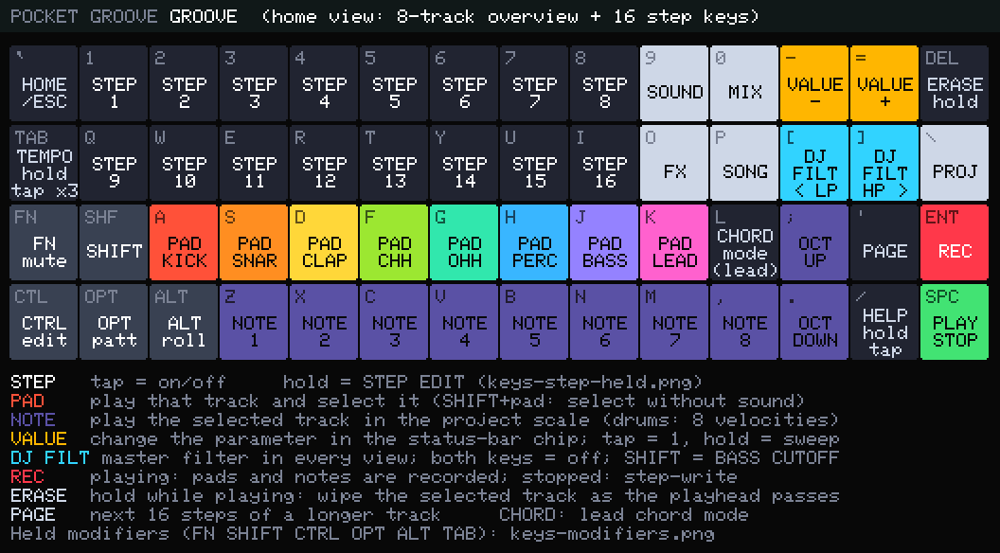

| Key | Action |
|---|---|
| `` ` `` | Home. Closes pop-ups, ends record mode, releases a held step without toggling it. |
| `1`-`8`, `q`-`i` | Step 1-16 of the shown page, selected track. Tap: on (at key-down) or off (at key-up). Hold 250 ms, or press another key while holding: STEP EDIT (4.2). |
| `9` `0` `o` `p` `\` | SOUND, MIX, FX, SONG, PROJECT. |
| `-` `=` | Focused value down / up. Hold = sweep with acceleration. Both together = default. |
| `del` | Hold while playing: erase the selected track as the playhead passes (undoable). Does nothing when stopped. |
| `tab` | Hold: tempo box (see 4.9). Tap 3 or more times: tap tempo. |
| `[` `]` | DJ filter: hold `[` = low-pass closing, hold `]` = high-pass opening, both = off, a quick tap = one step. |
| pads `a`-`k` | Play the track (velocity 100) and select it. |
| `l` | Lead selected: next chord mode (AUTO, AUTO7, fixed chords, see chapter 7). Other tracks: nothing. |
| `;` `.` | Octave up / down for the selected synth track (bass 0-4, lead 1-6). Drums: nothing. |
| `'` | Next 16-step page of the selected track (wraps). Pages don't follow the playhead. |
| `enter` | Record on/off. Stopped: step-write; playing: live record (4.3). |
| notes | Play the selected track: scale degrees 1-8 from the track's octave (drums: velocity 16, 32, 48, 64, 80, 96, 112, 127). On BASS and LEAD, pressing a note while another is held = slide. |
| `/` | Hold: key map of this view. Tap: explain mode. |
| `space` | Play / stop. Play always starts at step 1. |
| `fn` `shift` `ctrl` `opt` `alt` | Modifiers: hold one and press another key (4.9). |
| G0 (side button) | Hold and tilt the device: the selected track's two tilt macros move with it, from any view (4.4, "Tilt"). Hold + `-`/`=`: headphone volume; two taps: diagnostics (chapter 16). |

### 4.2 STEP EDIT (a step held in GROOVE)

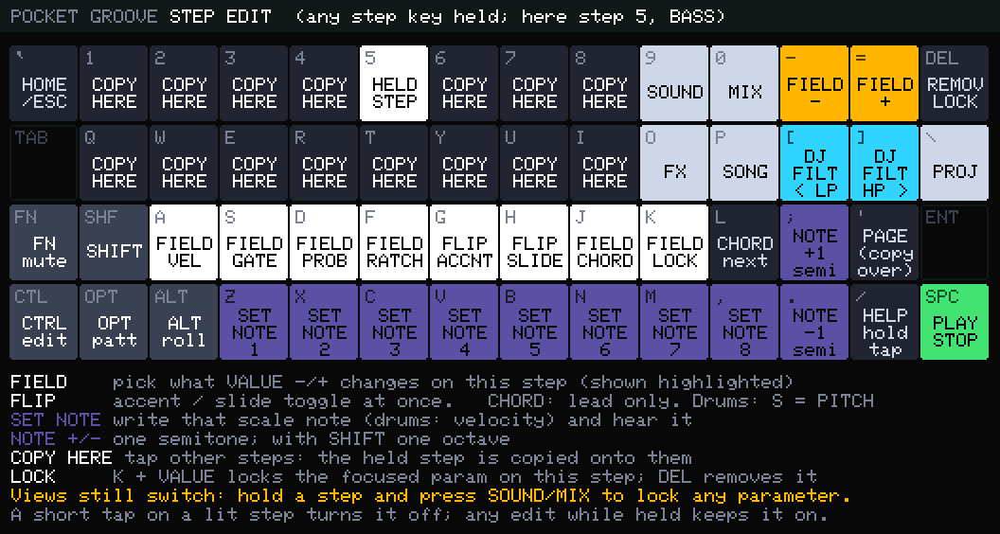
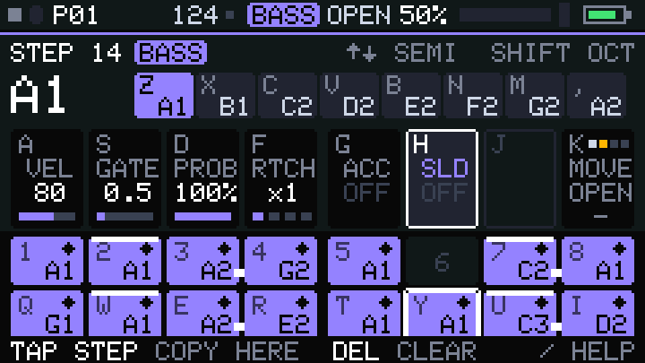

The key map says "with SHIFT one octave"; the octave is `ctrl`+`;`/`.` now (ghosting, see the table).

| Key | Action |
|---|---|
| pads `a`-`k` | Choose the field that `-`/`=` changes: `a` VEL, `s` GATE (drums: PTCH), `d` PROB, `f` RTCH, `g` ACC, `h` SLD (bass, lead), `j` CHRD (lead), `k` MOVE on an instrument track (the note's own macro values; `k` again: the next macro), LOCK on a CLASSIC track. The last field used is selected when the panel opens. |
| `-` `=` | Change the field. ACC and SLD flip on/off. Both together = field default (VEL 100, GATE 0.5 step, PTCH 0, PROB 100 %, RTCH x1, no chord, no lock or note value). |
| notes | Set the step's note (synth: scale degree at the track octave; drum: velocity) and hear it. |
| `;` `.` | Note +1 / -1 semitone, chromatic, so any note is reachable; `ctrl`+`;` / `ctrl`+`.` = an octave (earlier builds used `shift`; with step 1 held the keyboard can't tell `shift`+`;` from `shift`+`-`). Drums: pitch -24..+24. |
| `l` | Lead: next chord type (`shift`: previous). |
| other step keys | Copy the held step there (all fields). |
| `'` | Flip the page while holding, to copy across pages. |
| `del` | Remove the note's value of the focused macro (if it has none: all its values), or a CLASSIC step's lock. |
| `9` `0` `o` | Switch view and keep holding: note values or locks (chapter 10). |
| `` ` `` | Release the step and go home. |

Field ranges: VEL 1-127 (`shift` ±8); GATE 0.25-16 steps in quarter steps (default 0.5); PTCH -24..+24 semitones; PROB 0-100 % in 5 % steps (`shift` ±20 %); RTCH x1-x4 hits inside the step; CHRD OFF, OCT, 5TH, MAJ, MIN, MAJ7, MIN7, DOM7, SUS4, MIN9.

A step that was off and gets edited stays on. A short tap with no edit on a step that was on turns it off. `enter`, `tab`, `space`, `[` `]` and the modifier combos still work while a step is held (the key map shows `enter` and `tab` as unused; the code toggles record and opens the tempo box).

### 4.3 STEP-WRITE and live record

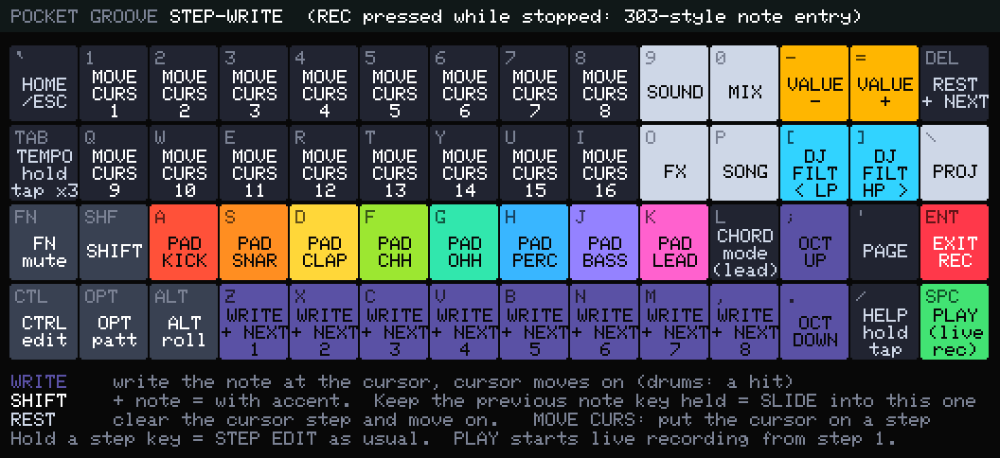

Step-write is record mode while stopped (`enter` with the transport stopped). The REC dot blinks, the footer says `STEP WRITE`, and an amber frame marks the cursor step.

| Key | Action |
|---|---|
| notes | Write the note at the cursor (synth: note, velocity 100, gate half a step; drum: a hit at that velocity), hear it, move the cursor on. Wraps at the track length and follows the page. |
| `shift`+note | The same, accented. |
| a note while the previous note key is still held | Slide from the previous step into this one (the 303 way). |
| `del` | Rest: clear the cursor step and move on. |
| step tap | Move the cursor there. Hold: STEP EDIT as usual. |
| `space` | Start playing: switches to live record. Stopping returns to step-write. |
| `enter` or `` ` `` | Leave record mode. |

Everything else works as in GROOVE (pads select and play, `;` `.` octave, `l` chord mode).

**Live record** is record mode while playing (`enter` while playing, solid red dot). Pads record onto their own track, notes onto the selected track, each quantised to the nearest step. On BASS and LEAD a note pressed while the previous is still held records a slide, the time you hold a note becomes its gate, and `shift`+note records an accent. Step keys still toggle steps.

### 4.4 SOUND (`9`): the instrument

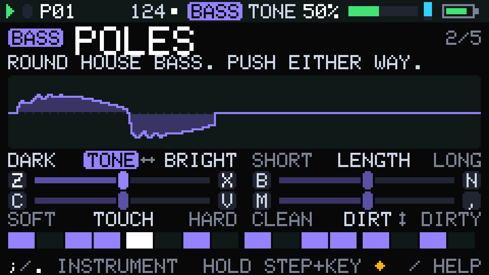

The page shows the selected track's instrument: its name, a live picture of its sound and its four macros. The picture is the track's own voice as an oscilloscope draws it: a held note stands still, a filter sweep reshapes it as you move, a drum hit draws its shape and decay from the left; it settles to a calm line when the track is silent.

The macros are four sliders, the left hand's on the left (`z` `x` macro 1, `c` `v` macro 2), the right hand's on the right (`b` `n` macro 3, `m` `,` macro 4). Each slider has its two keys at its ends: the left key moves it toward the left end, the right key toward the right. Words at the ends (DARK / BRIGHT) say what each end does. A small notch under a slider marks the instrument's default; ticks above it mark where the sound switches in a jump (a new wave, another filter) instead of moving smoothly. The macro you moved last has its name in the track colour; a macro you are moving right now turns white, with its key lit.

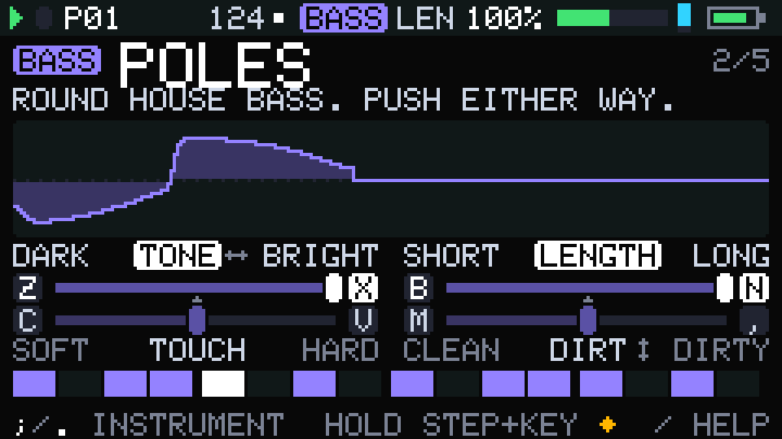

| Key | Action |
|---|---|
| `z` `x` `c` `v` `b` `n` `m` `,` | Move a macro down / up. Tap = a small step, hold = sweep (it speeds up), `shift` = big steps. Both keys of a pair = the instrument's default. Two macros can move at once: hold a key of each. The macro you moved is the focus, so `-`/`=` keep moving it from any view. |
| `.`, `9` again | Next instrument for this track: you hear it at once, a short list at the picture's right shows where you are (`2/5`). |
| `;` | Previous instrument. |
| `ctrl`+`z` | Right after changing instruments: back to what the track had (a run of `.` `.` `.` is one step back), again: forward. |
| `-` `=` | The focused macro. |
| pads | Select another track and show its instrument (and hear it). |
| steps | Tap toggles a step (the strip at the bottom shows them). Hold + a macro key (or `-`/`=`) = that note's own value of the macro (Motion, below; chapter 10); `del` removes it. |
| `del` held + a macro key | Clear that macro's motion: its values leave every note of this track in this pattern (`ctrl`+`z` brings them back). |
| `'` | Which 16 steps the strip shows. |

**Sampler instruments.** PERC's list ends with three instruments that play a sample instead of the percussion sound: CHOP, TAPE and STUTTER. Their picture is the sample's waveform, `shift`+`;` / `shift`+`.` choose which of the twelve sample slots the track plays, **holding `l` records the microphone into that slot**, and **holding `shift`+`l` records what the groove plays** (resampling, in whole bars). While `shift` is held the footer shows its layer. Chapter 20.

A track with no instrument shows **CLASSIC**: it plays its classic sound (projects from before instruments), the picture shows it, and two cards name what `.` or `9` (its first instrument) and `;` (its last) would pick. Each instrument remembers where you left its macros while the device is on. Everything else (`space`, `enter`, `[` `]`, modifiers) works as in GROOVE; `shift`+`[` `]` sweeps the bass's macro 1.

#### Motion

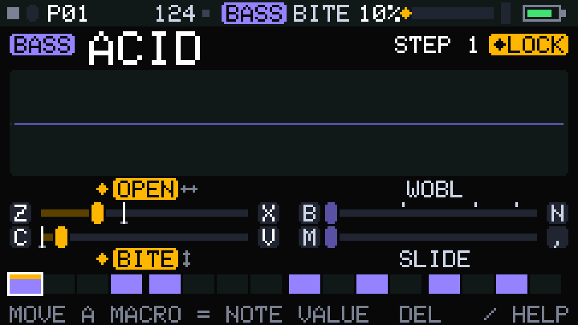

A note can carry its own value of each macro. Hold the step key and move a macro (its keys, or `-`/`=`): the slider turns amber and shows the note's value, a white tick shows the macro's position (its **base**). Move another macro while still holding: the note gets a value of that one too, up to all four. While the pattern plays, each macro then **glides in a straight line from one such note's value to the next one's**, arriving exactly as that note starts; it keeps moving through rests and past notes without a value, and from the last such note of the pattern toward the first one of whatever plays next (the same pattern again, a queued pattern, the next song slot). One note with a value: the macro just stays there. No note with a value in the playing pattern: the macro sits at its base. A value can't rise and fall within one note; a note followed by a long gap glides slowly.

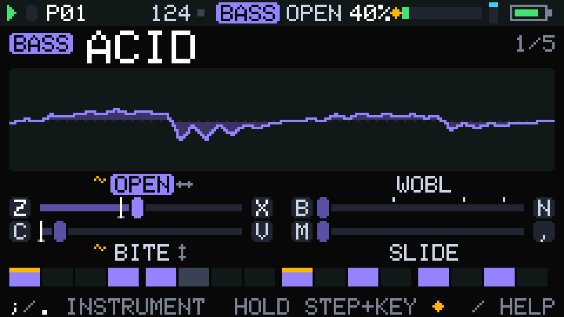

While it plays, the sliders of macros with motion move by themselves and a white tick marks their base. An amber ◆ before a macro's name means notes of this pattern carry their own values of it (also when stopped): the same ◆ a step with a value carries. It is not an LFO: the movement is the notes' values, so you change it by changing those. Moving such a macro by hand while it plays changes only its base (heard where a pattern has no values), so the page says so once (`OPEN FOLLOWS NOTES: HOLD STEP+KEY ◆`). While the macro you are moving has motion, the footer lists the three ways to change it: `STEP+KEY ◆` (hold a step and move the macro: that note's value), `REC+MOVE` (record it again, below), `DEL+KEY` (clear it, below).

**Recording motion**: turn REC on (`enter`) while playing and move a macro: it turns red (**live**). You hear your hand, and every note of the track that starts while it is live takes the macro's value. It stays live until you leave it alone for a bar, or turn REC off. `ctrl`+`z` takes back the whole pass (with any notes recorded in it).

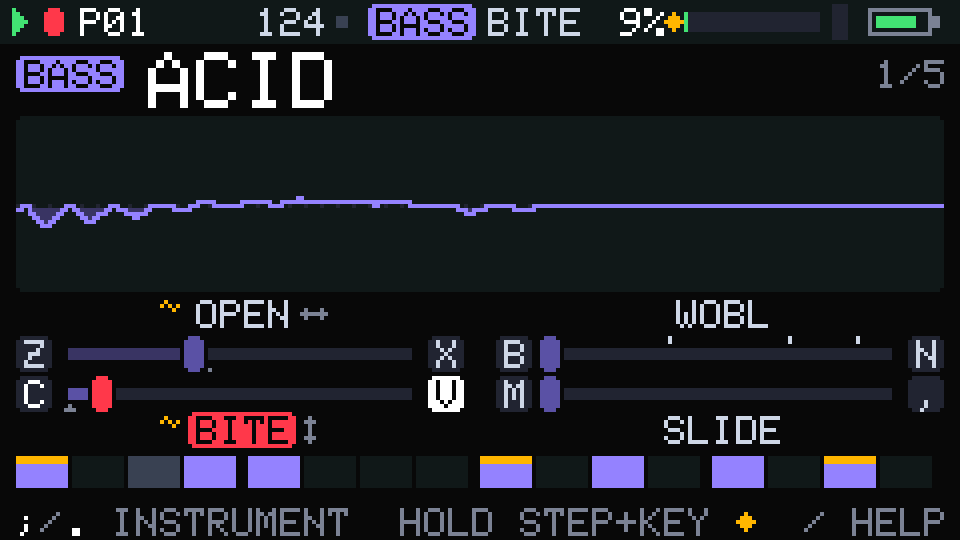

**Clearing**: hold `del` and tap one of a macro's keys: that macro's values leave every note of the track in this pattern (`ctrl`+`z` brings them back). To clear one note's value, hold the step and press `del`. When you stop, the sound rests where the motion left it until you move the macro; the page shows the base positions.

#### Tilt

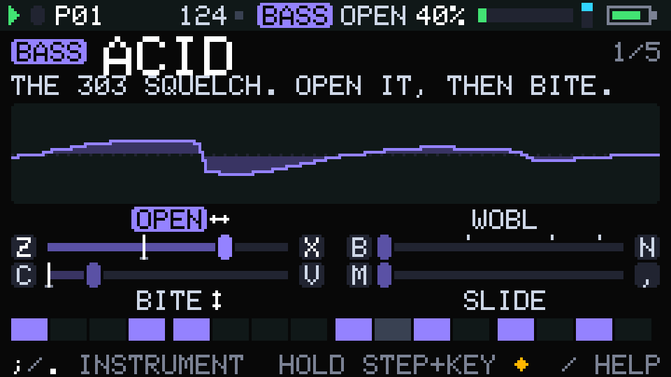

Hold **G0** (the small button on the top edge) and tilt the device. Roll it to the right (right side down) and the instrument's X macro goes up, to the left and it goes down; tip the far edge away from you and the Y macro goes up, toward you and it goes down. The angle you held it at when you pressed is the middle, so it works lying on the table or held up in front of you. Let go and the macros glide back to where they were. A comfortable wrist tilt, about 30 degrees, takes a macro from the middle to either end.

Which two macros move is the instrument's choice: usually the first two (OPEN and BITE on ACID), sometimes another pair (VOYAGE: GRIT and SPACE), or only one where the others would just click between settings (DICE: GLITCH). On the instrument page a small arrow beside a macro's name shows it: `↔` for rolling, `↕` for tipping; the arrows light while you hold G0, and the handles move with your hand while the white ticks stay at the macros' positions. Each instrument also chooses how its tilt responds: quick and twitchy, smooth (most), steady for fine moves, or slow and wide.

Tilt never changes your sound for good: the macros' positions, your notes and the saved project are untouched, and letting go brings back exactly what was there (a pattern with motion keeps playing its motion, with your tilt on top). It works from every view; outside the instrument page the status bar shows `TILT` and a dot for how far you are tilting.

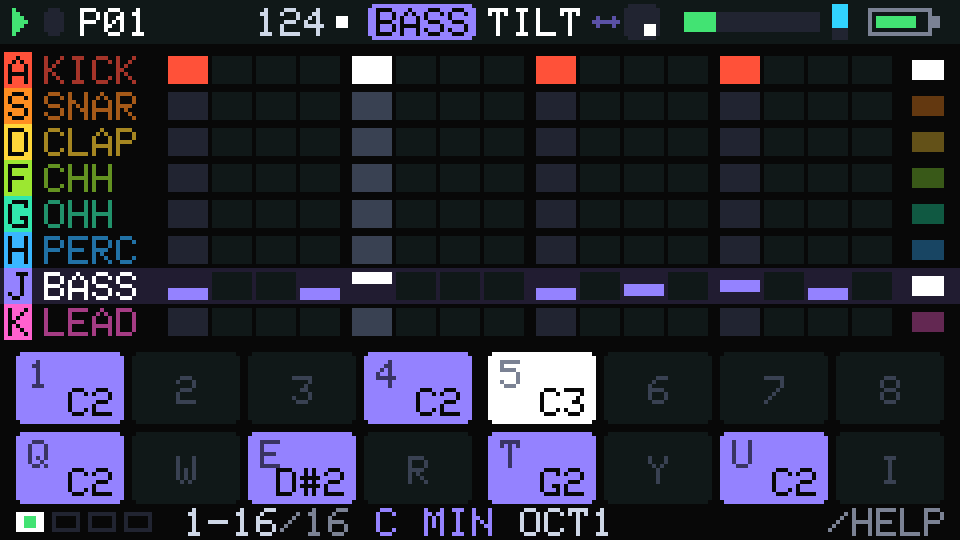

- A quick tap on G0 never moves anything (the double tap still opens the diagnostics strip).
- G0 + `-`/`=` still sets the headphone volume; pressing one of them ends the tilt for that hold.
- **Recording**: with REC on while playing, tilt and the notes that start while you hold G0 take what you hear (the macro's name and handle turn red); letting go of G0 ends it. `ctrl`+`z` takes back the pass. Just holding G0 without tilting records nothing.
- On a CLASSIC track tilt does nothing (a short message says so).
- On the desktop app (no tilt sensor) hold G0 (F1 or Esc) and move the mouse instead: right is rolling right, up is tipping away.

### 4.5 MIX (`0`)

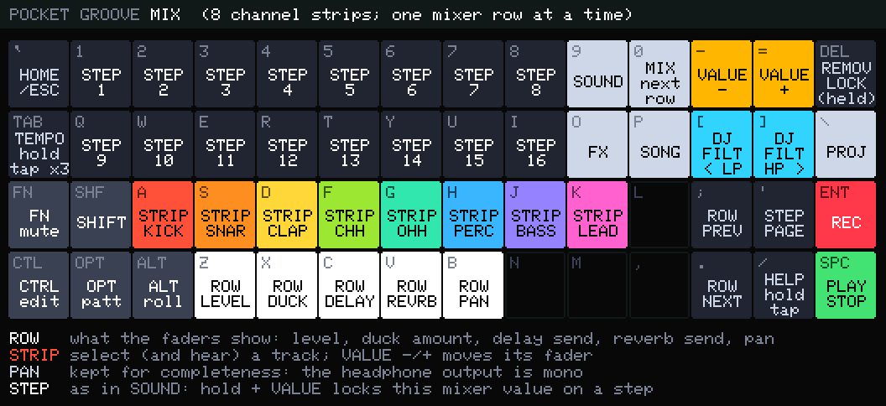
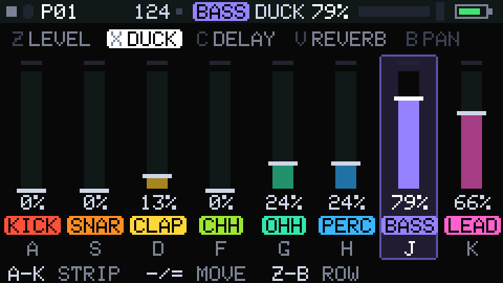

| Key | Action |
|---|---|
| `z` `x` `c` `v` `b` | Row: LEVEL, DUCK, DELAY (send), REVERB (send), PAN. `n` `m` `,` do nothing. |
| `0` again, `.` / `;` | Next / previous row. |
| pads | Select a strip (and hear it). |
| `-` `=` | Move the selected strip's fader in the current row. |
| steps | As in SOUND: hold + `-`/`=` locks the mixer value on that step. |
| `'` | Step page. |

PAN is drawn dimmed and the footer says `PAN: HEADPHONE OUT IS MONO`: pan is saved but has no effect on the device.

### 4.6 FX (`o`)

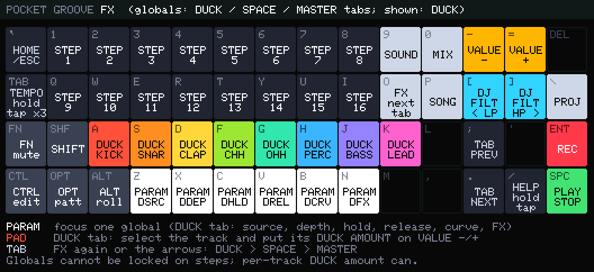
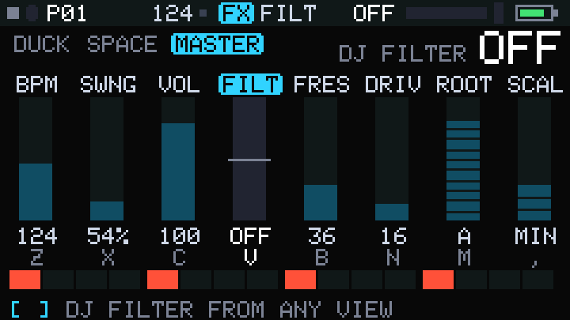

Three tabs: DUCK, SPACE (delay and reverb), MASTER. All values here are globals for the whole project.

| Key | Action |
|---|---|
| `o` again, `.` / `;` | Next / previous tab: DUCK > SPACE > MASTER. |
| notes | Focus a column. DUCK: `z` DSRC, `x` DDEP, `c` DHLD, `v` DREL, `b` DCRV, `n` DFX. SPACE: `z` DTIM, `x` DFB, `c` DTON, `v` RSIZ, `b` RDMP, `n` DWID. MASTER: `z` BPM, `x` SWNG, `c` VOL, `v` FILT, `b` FRES, `n` DRIV, `m` ROOT, `,` SCAL. |
| `-` `=` | Change it. |
| pads | Select a track (and hear it). On the DUCK tab the pad also puts that track's DUCK amount on `-`/`=`. |
| steps | Toggle steps. Globals can't be locked (`FX VALUES CAN'T BE LOCKED`); a track's DUCK amount can. |
| `'` `l` | Nothing. |

### 4.7 SONG (`p`)

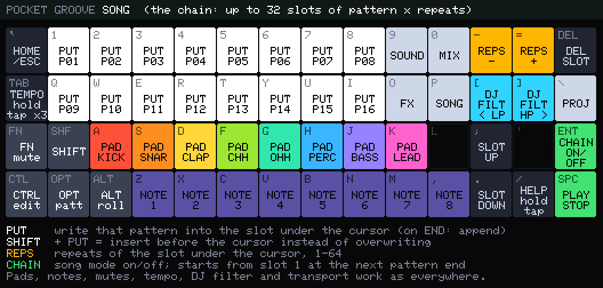
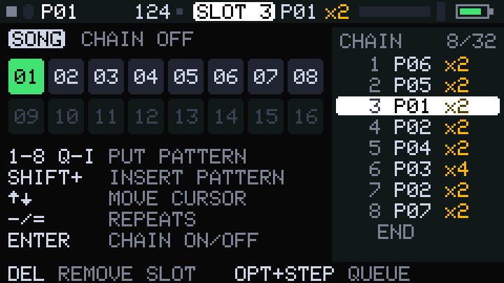

| Key | Action |
|---|---|
| steps | Put pattern P01-P16 into the cursor slot (keeps its repeats). On the `END` row: append, and the cursor stays on `END` for the next one. |
| `shift`+step | Insert the pattern before the cursor slot. |
| `;` `.` | Cursor up / down. |
| `-` `=` | Repeats of the cursor slot, 1-64 (`shift` ±8). |
| `del` | Remove the cursor slot. |
| `enter` | Song mode (chain) on/off, starting from the **cursor** slot. The key map says "from slot 1"; the code starts from the cursor. |
| `'` `l` | Nothing. |

Pads and notes play, and `opt`+step still queues a pattern.

### 4.8 PROJECT (`\`), name entry and dialogs

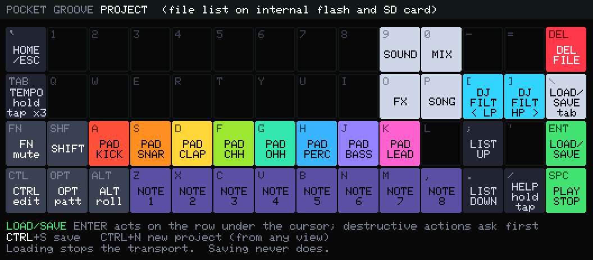
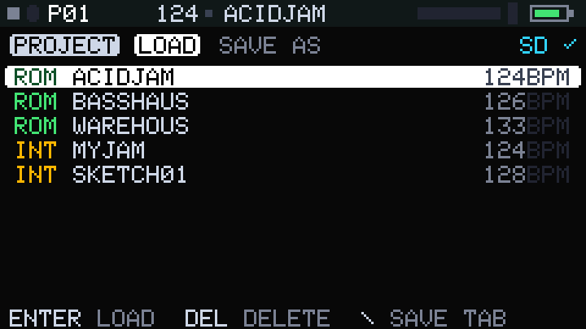

| Key | Action |
|---|---|
| `\` again | Switch between the LOAD and SAVE AS tabs. |
| `;` `.` | Move in the file list. |
| `enter` | LOAD tab: load the file (asks first if there are unsaved changes). SAVE AS tab: on `+ NEW NAME...` open name entry; on an existing INT or SD file, overwrite it (asks first). |
| `del` | Delete the file under the cursor (asks first). ROM demos can't be deleted. |
| steps, `-` `=`, `'`, `l` | Nothing. |

**Name entry** (the only mode where `space` doesn't play):

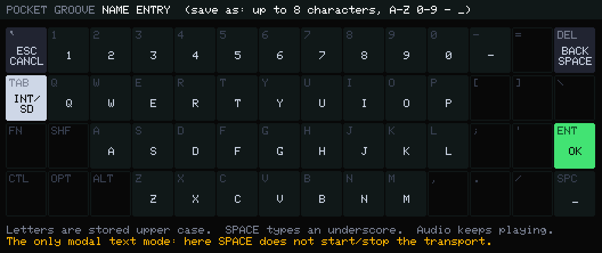

| Key | Action |
|---|---|
| `a`-`z`, `0`-`9` | Type (stored upper case). Up to 8 characters. |
| `-` | Types `-`. |
| `space` | Types `_`. |
| `del` | Backspace. |
| `tab` | Save to INT (internal flash) or SD. |
| `enter` | Save. Asks before overwriting an existing name; demo names are refused. |
| `` ` `` | Cancel. |

**Confirm dialogs** (`LOAD ...?`, `OVERWRITE ...?`, `DELETE ...?`, `NEW PROJECT?`): `enter` = yes, `` ` `` = no, `space` still plays and stops. Other keys are ignored.

### 4.9 Held modifiers (every view except dialogs)

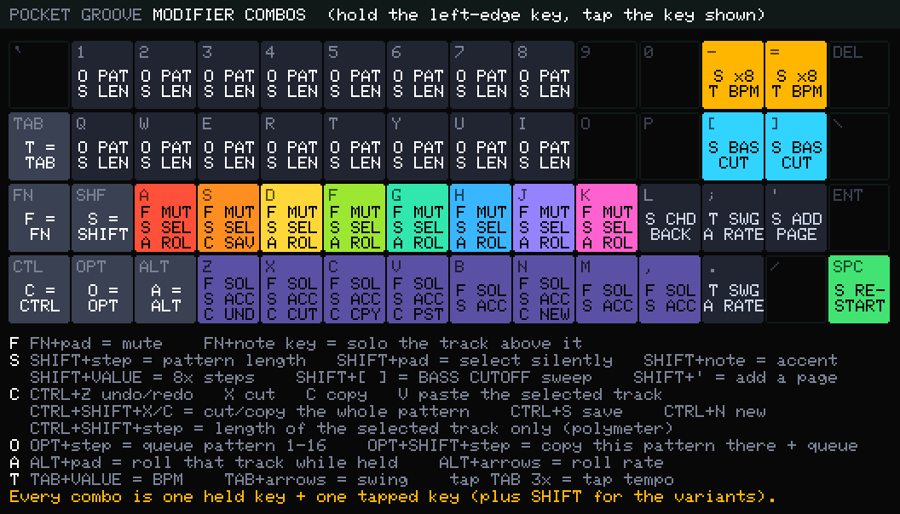

| Combo | Action |
|---|---|
| `fn` (hold) | Mute strip appears after 200 ms (at once when you press a combo key). |
| `fn`+pad | Mute / unmute that track. Immediate. Ends a solo, keeping the current mutes. |
| `fn`+note *k* | Solo track *k* (`z` = KICK ... `,` = LEAD). Same key again restores the mutes from before; another note key moves the solo. |
| `shift`+step | Pattern length = that step (all tracks). In SONG: insert. Undoable. |
| `shift`+pad | Select the track without sound. |
| `shift`+note | Play (or write) with accent. |
| `shift`+`-`/`=` | 8 steps at a time (1 for values with 16 or fewer positions). |
| `shift`+`[`/`]` | Sweep the BASS cutoff down / up. `shift`+both = back to where the sweep started. |
| `shift`+`'` | Add a page: every track grows by 16 steps (max 64), copying its previous 16. Undoable. |
| `shift`+`l` | Previous chord mode. |
| `shift`+`space` | Playing: restart from step 1. Stopped: continue from where it stopped. |
| `ctrl`+`z` | Undo; again = redo. |
| `ctrl`+`x` / `c` / `v` | Cut / copy / paste the selected track. |
| `ctrl`+`shift`+`x` / `c` | Cut / copy the whole pattern (paste with `ctrl`+`v`). |
| `ctrl`+`shift`+step | Length of the selected track only (polymeter). Undoable. |
| `ctrl`+`;`/`.` (step held) | Note ±12. |
| `ctrl`+`s` | Save (straight to the open file; a demo or unnamed project opens SAVE AS). |
| `ctrl`+`n` | New project (asks first if there are unsaved changes). |
| `opt` (hold) | Pattern pads appear: green = playing, amber frame = queued, grey = has steps, dark = empty. |
| `opt`+step *n* | Queue pattern *n*: it starts when the current pattern ends. Stopped: switches at once. |
| `opt`+`shift`+step *n* | Copy the playing pattern to *n*, then queue *n*. Undoable. |
| `alt` (hold) | Roll strip with the current rate. |
| `alt`+pad | Roll (retrigger) that track on the beat grid while held. Doesn't select it; not recorded. |
| `alt`+`;` / `.` | Roll rate faster / slower: 1/8, 1/16, 1/16T, 1/32. |
| `tab` (hold) | Tempo box after 250 ms. |
| `tab`+`-`/`=` | Tempo ±1 BPM (`shift` ±10). |
| `tab`+`;` / `.` | Swing up / down. |
| `tab` tapped 3+ times | Tap tempo (average of the last taps; a pause over 2 s starts again). |

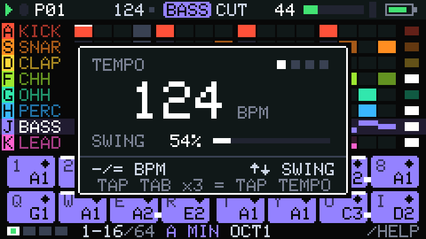

`fn`, `shift`, `ctrl`, `opt` or `alt` tapped on its own does nothing.

### 4.10 Help and explain mode

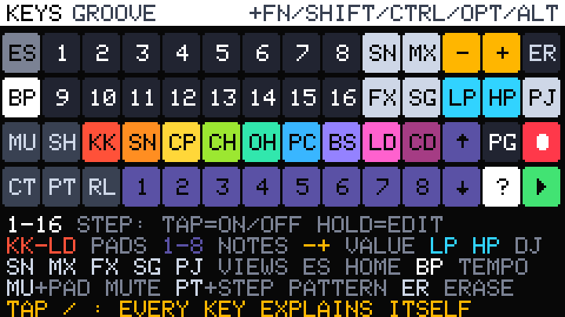

Hold `/`: the key map of the current view replaces the screen until you release it; hold a modifier as well to see that layer. Tap `/`: explain mode. Every key you press shows a short description instead of acting (hold a modifier while you press it to see that combo, e.g. `fn`+pad = mute); `space` still plays and stops; `/` or `` ` `` leaves.

---

## 5. Programming drums

**Lay down a beat**

1. Select the kick silently: `shift`+`a`.
2. Tap `1`, `5`, `q`, `t` (steps 1, 5, 9, 13): four on the floor.
3. Select the clap with `shift`+`d` and tap `5` and `t`.
4. Closed hats: `shift`+`f`, tap all eight upper steps or just the off-beats `3`, `7`, `e`, `u`.
5. `space` to hear it; keep editing while it plays.

**Velocity and accent.** Hold a step and press a note key: `z` (16) to `,` (127) sets its velocity. Or hold the step, press `a` (VEL) and use `-`/`=`. For an accent, hold the step and press `g` then `=`. An accented drum hits about 30 % harder (and the kick sweeps deeper, the clap gets brighter).

**Ratchets.** Hold the step, press `f` (RTCH), `=` up to x4: 2 to 4 even hits inside one sixteenth. Good on closed hats at the end of a bar or a snare build.

**Probability.** Hold the step, press `d` (PROB), `-` in 5 % steps. The step shows `%` and a dimmer colour. Ghost snares at 35-60 % and hats at 50-70 % keep a loop moving without new programming.

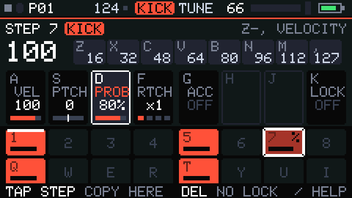

**Pitch per step.** On drums the `s` field is PTCH (-24..+24 semitones). `;`/`.` also move it. A tuned 808 kick or tom can play a melody this way.

**Copy a step.** Hold a step, tap other step keys: each gets a copy (velocity, accent, ratchet, everything).

**Per-track length and polymeter**

- `shift`+step *n* sets the pattern length to *n* for all tracks (the patterns start at 16).
- `shift`+`'` adds a page of 16 to every track, copying the previous 16, up to 64.
- `ctrl`+`shift`+step *n* sets only the selected track's length. A 12-step hat line against a 16-step kick drifts against it, giving the 3-against-4 feel. All tracks restart together when the pattern (its master length) starts again, so make the pattern long (`shift`+`'` up to 64 steps) to give a polymeter room to evolve. The WAREHOUS demo uses a 12-step stab and 7- and 12-step percussion inside 64-step patterns.
- Steps beyond a track's length are drawn as outlines; tapping one shows `BEYOND LENGTH - SHIFT+STEP SETS LENGTH`.

Length changes are undoable with `ctrl`+`z`.

**Open and closed hats.** A closed-hat hit cuts off a ringing open hat, as on the classic machines.

---

## 6. Writing a bassline, three ways

Select the bass with `shift`+`j`. The note keys play eight notes of the project scale from the bass octave (in A minor at octave 1: A1 B1 C2 D2 E2 F2 G2 A2). `;` and `.` change the octave. The scale is set in FX > MASTER (`o` until MASTER, `m` ROOT, `,` SCAL).

### 6.1 Scale-locked note row, step by step

1. Tap the steps you want (`1`, `3`, `4`, `7`...). A new synth step gets the first note of the scale.
2. Hold a step and press a note key to set its note; you hear it. `;`/`.` while holding moves it by a semitone for notes outside the scale.
3. Still holding: `g` then `=` for an accent; `h` then `=` for a slide into the next step; `s` (GATE) with `-`/`=` for the length.

### 6.2 303-style step-write

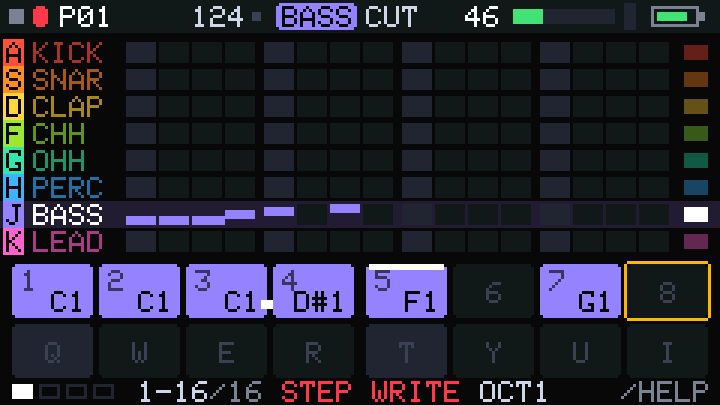

1. Stop the transport (`space`), select the bass, press `enter`. The cursor sits on step 1 of the shown page.
2. Type the line with the note keys: each key writes a note and moves on.
3. `shift`+note writes an accented note.
4. For a slide, keep the previous note key held while you press the next one: the previous step slides into the new note.
5. `del` writes a rest. Tap a step key to move the cursor.
6. Press `space` to hear it (you are now in live record), `space` again to stop, `enter` to leave.

The screenshot above came from this sequence on an empty project: `enter`, `z`, `z`, hold `z` + `c`, `shift`+`v`, `del`, `b`.

### 6.3 Live record

1. Press `space`, then `enter` (solid red dot).
2. Play the note keys along with the loop. Notes land on the nearest sixteenth; how long you hold sets the gate; legato (pressing the next key before releasing the last) records a slide; `shift` records an accent.
3. Press `enter` to stop recording. Didn't like it? `ctrl`+`x` clears the track (and `ctrl`+`z` brings it back).

**Bass slides and glide.** A slide holds the note and glides into the next step's pitch without retriggering. The glide time is SLID on SOUND page 3 (`9` `9` `9`... then `z`). Accents use the ACC amount on page 1.

---

## 7. Chord stabs on the lead

Select the lead (`shift`+`k`). Every note key plays a chord, chosen by the **chord mode** shown in the footer.

| Chord mode (`l` cycles, `shift`+`l` back) | What a note key plays |
|---|---|
| `AUTO` (default) | The triad built on that scale degree, always in key: minor, major or sus4; a degree without a usable triad gets a fifth or an octave. |
| `AUTO7` | The four-note seventh chord on that degree (MAJ7, MIN7, DOM7), else as AUTO. |
| `NONE` | Single notes. |
| `OCT` `5TH` `MAJ` `MIN` `MAJ7` `MIN7` `DOM7` `SUS4` `MIN9` | That chord on every key. |

In A minor with AUTO the keys `z` to `,` play Am, B (octave), C, Dm, Em, F, G, Am; with AUTO7 Am7, B (octave), Cmaj7, Dm7, Em7, Fmaj7, G7, Am7. The voicings are made for stabs: triads add the octave, MIN9 is root, minor third, minor seventh and ninth (the deep-house voicing). The lead has four voices, so a four-note chord uses all of them; overlapping chords take over the oldest voices.

1. Pick a mode with `l` (`MIN9` or `AUTO7` for deep house, `MIN` or `5TH` for techno).
2. Tap steps: a new lead step gets the chord of the first scale degree in the current mode.
3. Hold a step and press a note key to change its root; `j` (CHRD) and `-`/`=`, or `l`, changes the stored chord type of that step only.
4. Short stabs: keep the gate short (0.5 step) and SUS at 0 (SOUND page 2, `c`).

House rhythms that work: steps 4, 7, 11, 14 (`4` `7` `e` `y`, the ACIDJAM stab), or the off-beats 3, 7, 11, 15 (`3` `7` `e` `u`). Add delay (MIX, DELAY row) and some ducking (chapter 8).

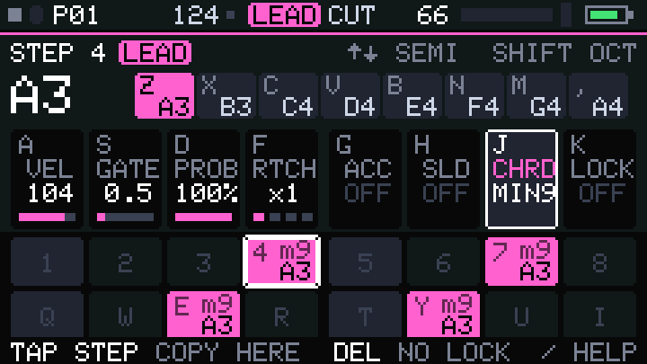

The chord mode and octaves are remembered across power cycles.

---

## 8. Sidechain ducking

**What it does.** The ducker turns chosen tracks down for a moment every time it's triggered, normally by the kick, and lets them swell back before the next beat. It makes room for the kick in the low end (the bass doesn't fight it) and gives house its breathing "pump". There's no compressor and no audio detection: it is a gain envelope started by the sequencer, so it is exactly on time.

Two things decide how much a track moves:

- the global ducker settings on the **DUCK page** (FX view, first tab): what triggers it, how deep, how long;
- each track's **DUCK amount** (0-100 %): how much of that dip this track gets. The kick itself stays at 0 %.

The dip a track gets is roughly DDEP x DUCK. With the defaults (DDEP 79 %, BASS DUCK 87 %) the bass drops by about 70 %, roughly -10 dB, at every kick.

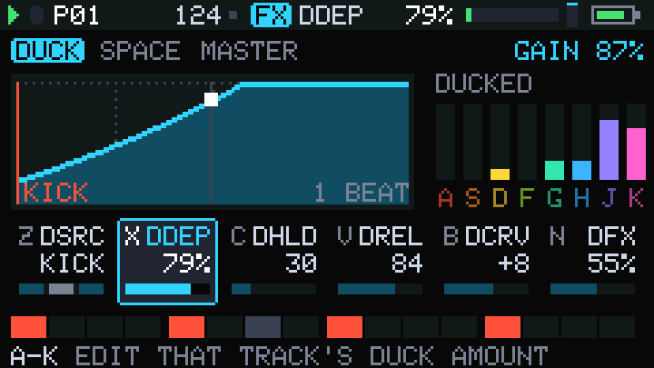

**The DUCK page** (`o`, first tab). The curve shows one beat at the current tempo: down at the trigger line, hold, then the recovery. The white dot is where the ducker is right now, and `GAIN 87%` at the top right is the live gain. The bars on the right are the eight tracks' DUCK amounts. The cards are the six parameters, focused with `z` to `n`:

| Key | Param | What it does |
|---|---|---|
| `z` | DSRC | Trigger: `OFF`, `KICK`, `BEAT`. |
| `x` | DDEP | Depth of the dip. |
| `c` | DHLD | How long it stays fully down: 200 ms x (value/127)². |
| `v` | DREL | Recovery time, 20 ms to 1 s. |
| `b` | DCRV | Recovery shape: negative = snaps back early, positive = stays down, then swells. |
| `n` | DFX | How much the delay and reverb returns are ducked too. |

**Per-track amounts.** Three ways, pick whichever is at hand:

1. On the DUCK page, press a pad: the header shows that track's name and amount, and `-`/`=` change it.
2. In MIX (`0`), press `x` for the DUCK row, choose a strip with its pad, `-`/`=`.
3. As a parameter lock, for one step only: in MIX on the DUCK row, hold the step and press `-`/`=`.

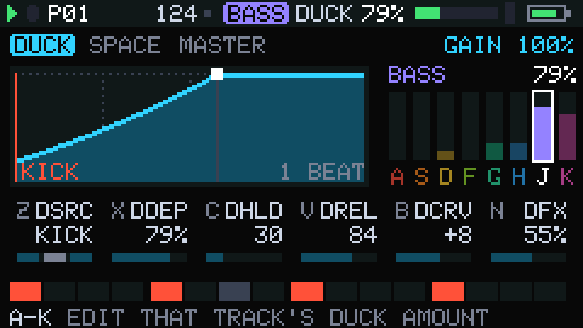

**KICK or BEAT?**

- `KICK` follows the kick that you hear: every kick hit, including ratchets and ghost kicks. A muted kick, or a kick step that loses its probability roll, doesn't pump. Use it when the kick pattern is the groove (four on the floor, broken kicks you want the bass to follow).
- `BEAT` fires on every quarter note of the grid while playing, whatever the kick does. Use it in breakdowns where the kick is muted or absent but the pads should keep breathing, for off-beat or half-time kick patterns where you still want a steady pump, and when you solo something without the kick.

**Recipe: subtle glue** (the bass gets out of the kick's way; you shouldn't consciously hear a pump)

| Where | Setting |
|---|---|
| FX > DUCK | DSRC `KICK`, DDEP 44 % (raw 56), DHLD 0, DREL 60 (about 130 ms), DCRV -8 (raw 56), DFX 31 % (raw 40) |
| MIX > DUCK | BASS 50 % (64), LEAD 35 % (44), OHH and PERC 20 % (26), everything else 0 % |

The bass dips about 2-3 dB and is back well before the next beat.

**Recipe: hard bass-house pump** (the BASSHAUS demo's settings, 126 BPM)

| Where | Setting |
|---|---|
| FX > DUCK | DSRC `KICK`, DDEP 90 % (114), DHLD 40 (about 20 ms), DREL 80 (about 235 ms), DCRV +6 (70), DFX 63 % (80) |
| MIX > DUCK | BASS 94 % (120), LEAD 76 % (96), OHH 31 % (40), PERC 24 % (30), CLAP 8 % (10), KICK, SNAR, CHH 0 % |

The bass drops about 16 dB at each kick and swells back over half a beat. To push it further: DDEP 100 % (127), DREL 88-96 (300-385 ms, nearly the whole beat at 126 BPM) and DCRV +20 (84), so it stays down longer and swells late. Give the bass a long sustained note (ADCY 127) so there's something to pump; short plucks hide the effect.

**Tips**

- Match DREL to the tempo: one beat is 484 ms at 124 BPM, 476 ms at 126, 451 ms at 133. A recovery that ends just before the next kick sounds biggest.
- Keep DFX up when you use long delays or reverb; otherwise the tails wash over the kick.
- The status-bar cyan bar shows the ducking on every screen.
- WAREHOUS ducks its kick's own reverb (DFX 87 %, KICK reverb send) to make a pumping techno rumble.
- Ducking settings are per project, not per pattern; vary them per step with DUCK-amount locks.

---

## 9. Sound design recipes

These recipes set the bare sound parameters. Since instruments, the device shows instruments and their macros instead (4.4); the parameters themselves can still be set in the desktop app's developer mode (`--dev`), on a CLASSIC track. Where a recipe names a demo (ACIDJAM, BASSHAUS, WAREHOUS), it gives that demo's classic voicing: the demos themselves now play instruments (chapter 14). Values are as shown on screen; a raw value in brackets where the screen shows something else (`-`/`=` move the raw value). Anything not listed stays at its default (chapter 19). Page numbers are the developer mode's SOUND pages.

### Bass

**Acid bass** (ACIDJAM's 303 line)

| Page | Settings |
|---|---|
| 1 | CUT 44, RES 112, ENV 66, DCY 50, ACC 104, DRV 52 |
| 2 | SUB 34 |
| 3 | SLID 58, ADCY 96, KTRK 50 |

The bass designer's own "acid" preset is brighter and wetter: CUT 30, RES 112, ENV 95, DCY 50, DRV 50, SUB 25. Program accents on 3-4 steps a bar, slides on 2-3, octave jumps (`z` and `,`). Ride RES (`x`) and ENV (`c`) live.

**Bass-house growl** (BASSHAUS, the designer's "growl")

| Page | Settings |
|---|---|
| 1 | CUT 34, RES 70, ENV 30, DCY 70, ACC 60, DRV 85, LFO 62, RATE 1/8 |
| 2 | WAVE 20, SUB 90, FMIX 70, FM 70, RATI 1, FOLD 60, TENV 20, LSHP SINE |
| 3 | ADCY 127, REL 40, KTRK 70, LTMB 70 (the designer's version adds SUBO -1OCT) |

The character comes from per-note locks (chapter 10): lock FOLD 96-127, FM 110-127 or FMIX 127 on single notes, and RATE 1/16 or 1/16T on long notes for a faster wobble. Duck hard (chapter 8).

**Deep sub** (the designer's "sub")

| Page | Settings |
|---|---|
| 1 | CUT 0, RES 0, ENV 0, DRV 0 |
| 2 | SUB 127 |
| 3 | ADCY 110, REL 40, KTRK 0 |

A clean sine. Long gates, octave 1. Mostly felt on headphones; on the built-in speaker you'll barely hear it.

**Plucky house bass**: the default bass sound of a new project is voiced as one (CUT 46, RES 78, ENV 70, DCY 44, ACC 90, DRV 30, SUB 56, ADCY 96). Put notes on the off-beats and the sixteenths around them (steps 3, 4, 6, 7, 11, 12, 15, 16), short gates, a few accents.

**Rolling techno bass** (WAREHOUS): CUT 26, RES 44, ENV 40, DCY 30, ACC 70, DRV 64; page 2 SUB 84, LSHP SINE; page 3 ADCY 30, REL 20, KTRK 30. Notes on the three sixteenths after every kick, cutoff locked a little higher each beat.

### Drums

**909-style kick**: the defaults (TUNE 60, DCY 46, PNCH 76, SWP 58, CLK 72, DRV 28, TONE 100, HOLD 30; page 2 HARM 36, CTON 56). ACIDJAM tunes it to A (TUNE 66, PNCH 82, DRV 38).

**808-style kick**: TUNE 50, DCY 92, PNCH 40, SWP 40, CLK 30, DRV 22, TONE 70, HOLD 0; page 2 HARM 20, CTON 20. Long and boomy; give the bass less low end (lower SUB) or less sustain so they don't collide. With PTCH per step it can play a bassline.

**Hard techno kick** (WAREHOUS): TUNE 54, DCY 46, PNCH 94, SWP 66, CLK 84, DRV 84, TONE 84, HOLD 40; page 2 HARM 60, CTON 80.

**Crisp closed hats**: TUNE 100, DCY 20, TONE 110, SNAP 110 (the designer's "tick"). A softer house hat: DCY 44, TONE 84 (ACIDJAM). Vary velocity per step (100/55/80/55) and put a 50 % probability on the last one of the bar.

**Open hat**: DCY 54, TONE 74 on the off-beats (`3` `7` `e` `u`); the closed hat cuts it off.

**Clap**: tight and dry: TONE 76, DCY 20, SPRD 40, TAIL 30, BRST 2, DRV 70. Big room: TONE 44, DCY 100, SPRD 86, TAIL 110, BRST 4, RES 36, AIR 70.

**Snare**: tight, rimmy techno snare (BASSHAUS, layered under the clap): TUNE 96, DCY 22, SNAP 52, TONE 96, BODY 28, BEND 30, RING 100, DTUN 76; page 2 DRV 70.

### Lead

**House chord stab**: the lead's default sound is one. ACIDJAM's: CUT 66, RES 28, ENV 56, FDCY 46, DET 50, DCY 54; page 2 SUS 0, REL 40, DRV 18. MIN9 chords on steps 4, 7, 11, 14, MIX delay 55 % (70), reverb 35 % (44), duck 66 % (84).

**Organ** (BASSHAUS's M1-style organ, the designer's "organ house")

| Page | Settings |
|---|---|
| 1 | CUT 104, RES 0, ENV 24, FDCY 30, WAVE ORGN, SHP 64, DCY 60 |
| 2 | SUS 100, REL 16 |
| 3 | MIX -64 (raw 0) |

MIN7 and MAJ7 chords, short gates. Raise SHP towards 110 to pull out more drawbars.

**Techno stab** (the designer's "techno stab")

| Page | Settings |
|---|---|
| 1 | CUT 24, RES 96, ENV 36, FDCY 50, WAVE SUPR, SHP 60, DET 70, DCY 64 |
| 2 | SUS 0, REL 36, DRV 50 |
| 3 | MIX -64 (raw 0) |

MIN or 5TH chords. Open CUT from 24 to about 100 over several bars (live, or with locks), then close it again.

**Dub stab** (WAREHOUS): CUT 40, RES 64, ENV 44, FDCY 38, DET 44, DCY 50; page 2 SUS 0, REL 50, DRV 30. MIN9 chord on a 12-step track (`ctrl`+`shift`+`e`), delay 1/8D with DFB 66 % (84) and DTON -28 (36), delay send 76 % (96).

---

## 10. Note values and parameter locks

**On a track with an instrument** a note carries its own values of the instrument's macros, one per macro, up to all four on the same note; between notes each macro glides from one value to the next (chapter 4.4, "Motion"). A brighter bass note, a filter that opens over a bar, a wobble that speeds up toward the drop.

1. Go to SOUND (the instrument page).
2. Hold the step key. The header turns amber (`◆LOCK`).
3. Press a macro's key (or `-`/`=` for the focused one): the note's value starts one level from the macro's position and moves a level per tap (63 levels; `shift`: 4). Both keys of the pair: its default. Another macro's keys give the note a value of that one too.
4. Release the step.

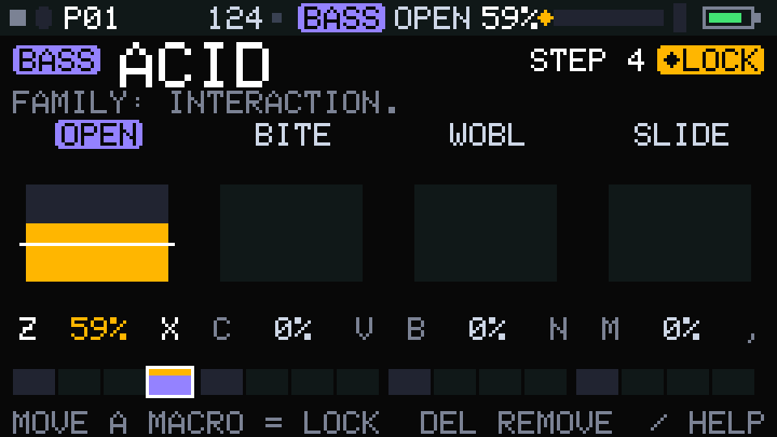

You can also start in GROOVE: hold the step, then press `9` without letting go. **From STEP EDIT**: hold the step, press `k` (MOVE), `-`/`=`: the value of the track's focused macro (the one you last moved in SOUND); `k` again picks the next macro. **Remove**: hold the step and press `del` (the focused macro's value; again: all of them), or `-` and `=` together in the MOVE field. **Seeing them**: ◆ on the step pad; an amber top edge on the step strip; while the step is held, the values in amber.

An instrument track has **no parameter locks**: the instrument owns its sound, and the MIX values are the track's. (A project saved before version 3 keeps its macro locks as the notes' values; its sound and mixer locks on instrument tracks are dropped when it loads.) Choosing an instrument for a CLASSIC track clears its locks in every pattern, and going back to CLASSIC clears its notes' values.

**On a CLASSIC track** (the demos, older projects) a lock gives one step its own value for one parameter (in developer mode) or one MIX value: a longer clap, a delay throw on one stab. **One lock per step.** The lock holds from that step until the next step of the same track that plays. Hold the step key in MIX (or FX DUCK, for a track's DUCK amount) and press `-`/`=`; moving another value replaces the lock (toast `LOCK CUT REPLACES RES`). STEP EDIT's `k` is LOCK there.

Globals (everything in FX except the DUCK amounts) can't be locked. A bass note with its own value of macro 1 is not moved by the bass sweep (`shift`+`[` `]` moves macro 1's base, which plays where a pattern has no values).

---

## 11. Performance

**Mutes and solo.** Hold `fn`: the strip shows every track. `fn`+pad mutes; `fn`+note key solos (`z` KICK through `,` LEAD); the same note key again restores the mutes you had. Mutes are immediate, belong to the project (they persist across patterns and are saved), and aren't undoable.

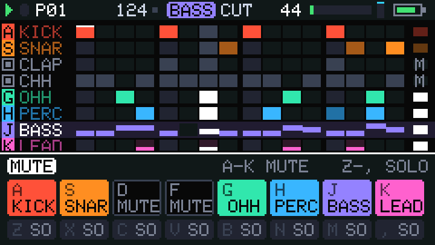

**Pattern queue.** `opt`+step queues pattern 1-16; it starts at the end of the current pattern, and the status bar shows `P01>02` until then. Queuing the playing pattern cancels the queue. In song mode a queued pattern is a one-off detour; the chain carries on afterwards.

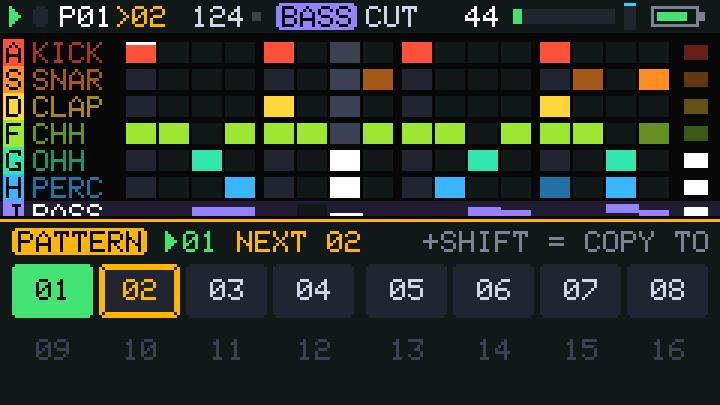

**Copy-then-queue to build variations.** `opt`+`shift`+step *n* copies the playing pattern to *n* and queues it. When it starts, change something (drop the kick, add hats, a new bass line), then copy that to the next slot. `ctrl`+`z` restores the destination's old contents.

**Roll.** `alt`+pad retriggers that track on the beat grid while you hold it: hat or snare rolls into a drop. `alt`+`;`/`.` changes the rate (1/8, 1/16, 1/16T, 1/32). Two pads can roll at once. Rolls aren't recorded.

**DJ filter.** Hold `[` (low-pass) or `]` (high-pass) in any view. It moves at a fixed rate (about 1.3 s from OFF to fully closed or fully open) and stops where you let go; it pauses briefly at OFF when you sweep through. `[`+`]` together = off. Resonance is FRES in FX > MASTER.

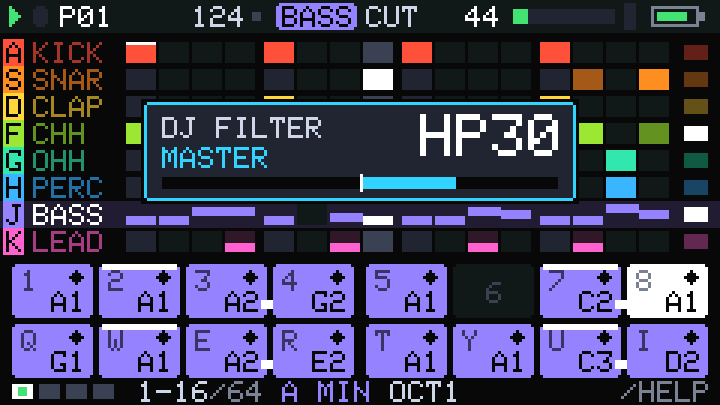

**Bass sweep.** `shift`+`[`/`]` sweeps the bass's macro 1 the same way (OPEN on ACID, the instrument a new project starts with), from any view; `shift`+both returns it to where you started. On a CLASSIC bass (an older project) it sweeps the cutoff, as before instruments; steps with a CUT lock ignore it. While the playing pattern gives macro 1 notes their own values, the sweep moves only its base; the factory demos' jam patterns (P1-P3, P8) never do, so there it is always heard.

**Tilt.** Hold G0 and tilt: the selected track's two tilt macros move with your hand and glide back when you let go, from any view (4.4, "Tilt"). With REC on it records into the notes like moving the macro keys.

**Erase.** Hold `del` in GROOVE while playing: the selected track's steps are cleared as the playhead passes. `ERASE` shows in the footer. `ctrl`+`z` brings them back.

**Tempo and swing.** Hold `tab`: `-`/`=` tempo, `;`/`.` swing. Tap `tab` three or more times for tap tempo. Swing delays every second sixteenth: 54-58 % for house.

---

## 12. Song mode

A song is a chain of up to 32 slots, each a pattern and a repeat count. After the last slot it loops back to the first.

1. Press `p`. The left side shows the 16 patterns (green = playing, grey = has steps), the right side the chain.
2. Move the cursor to `END` with `.` and tap step keys to append patterns (`1` = P01).
3. Move to a slot with `;`/`.`; `-`/`=` sets its repeats; a step key replaces its pattern; `shift`+step inserts before it; `del` removes it.
4. Put the cursor on the slot to start from and press `enter`: `CHAIN ON`. Stopped, the song jumps there and `space` plays it; while playing, it enters that slot at the end of the current pattern.
5. `enter` again switches song mode off; the current pattern then loops.

While the chain plays, the status bar shows the slot number in green and the playing slot is marked in the list with a progress line. The chain is saved with the project.

---

## 13. Copy, paste, undo

| Keys | What | Undo |
|---|---|---|
| `ctrl`+`c` | Copy the selected track (in the playing pattern) | - |
| `ctrl`+`x` | Cut it (copy, then clear) | yes |
| `ctrl`+`shift`+`c` | Copy the whole pattern | - |
| `ctrl`+`shift`+`x` | Cut the whole pattern | yes |
| `ctrl`+`v` | Paste: a track clip onto the selected track, a pattern clip onto the playing pattern | yes |
| `opt`+`shift`+step | Copy the pattern to another slot and queue it | yes (the destination) |
| `shift`+step, `ctrl`+`shift`+step, `shift`+`'` | Length changes, add page | yes |
| `del` held (erase) | | yes |
| Step taps, STEP EDIT changes, copying a held step, step-write notes and rests | | yes |
| A live recording pass | | yes (the whole pass) |

- A track pastes onto the same kind: drum to drum, bass or lead to bass or lead (`CAN'T PASTE DRUMS ON BASS` otherwise). Pasting onto a different voice drops chords (except on the lead) and sound-parameter locks; pasting onto another track or another instrument drops the notes' macro values. The paste also sets the track's length.
- To copy a track to another pattern: `ctrl`+`c`, switch pattern with `opt`+step (wait for it to start, or do it stopped), `ctrl`+`v`.
- **Undo is one level** and covers one pattern: `ctrl`+`z` swaps the pattern back to how it was before the last undoable action; `ctrl`+`z` again redoes it. A new undoable action replaces the snapshot. Every change to a pattern's steps and lengths is undoable, and one gesture is one action: everything done while one step key is held (placing it, every nudge of its note, fields and values, copies to other steps, deleting it on a tap) undoes together; so does one `del` erase pass, one clear of a macro's motion, and one live recording pass (from the first recorded note or recorded macro move until `enter` turns REC off or the transport stops). Two separate taps are two actions, so `ctrl`+`z` takes back only the second. The toast names what it takes back, e.g. `UNDO: KICK STEP 5`, `UNDO: RECORDED NOTES`.
- Not undoable: sound and mixer values, mutes, song chain edits, tempo, swing and the scale. Loading a project clears undo and the clipboard.

---

## 14. Projects and files

**What a project holds**: all 16 patterns, the song chain and song mode, every sound and mixer setting, mutes, and the globals (tempo, swing, scale, ducker, delay, reverb, master). Not in the project: the octave and chord-mode settings (kept in a small settings file) and the headphone volume (firmware settings).

**Where**: `INT` is the internal flash (1.5 MB, always there); `SD` is a microSD card (FAT32), files in `/pg/` on the card. Files are named `NAME.pgv`, 1-8 characters from A-Z, 0-9, `-` and `_`. `ROM` rows are the three factory demos, built into the firmware: they load but can't be overwritten or deleted. The list shows ROM, then INT A-Z, then SD A-Z, with each file's tempo (`BAD` if the file is damaged; `enter` on it tells why). The header shows `SD ✓` or `NO SD`.

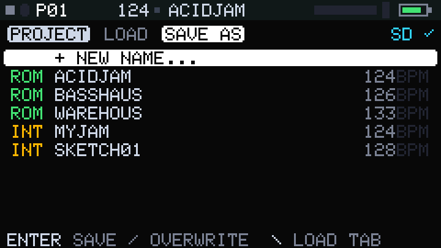

**Save**

- `ctrl`+`s` from anywhere: saves straight to the open file (`SAVED MYJAM`). A demo or a new project opens SAVE AS instead.
- SAVE AS: `\` opens PROJECT, `\` again switches between the LOAD and SAVE AS tabs; on `+ NEW NAME...` press `enter`. A suggested name `GROOVE01` (the next free number) is filled in; `del` erases, type a new one, `tab` picks INT or SD, `enter` saves.
- To save over an existing file: SAVE AS tab, cursor on the file, `enter`, confirm with `enter`.
- **Stop before saving to INT.** Writing internal flash pauses the processor for a moment; while playing you'll hear a dropout. Saving doesn't stop the transport.

**Load**: PROJECT, LOAD tab, cursor on a row, `enter`. If the open project has unsaved changes you're asked first (`enter` discards them, `` ` `` cancels). Loading stops the transport and goes to GROOVE with the bass selected.

**New**: `ctrl`+`n` (asks first if there are unsaved changes). An empty project: C minor, 124 BPM, default sounds, patterns of 16 steps, ducker on (KICK).

**Delete**: cursor on the file, `del`, `enter`. It can't be undone.

**Session resume and the power switch.** The device has a hard power switch and does not save when you switch it off. Instead it keeps a session file that it writes by itself:

- 2 s after you stop the transport, and
- after 10 s without a key press while stopped,

but only if something changed, and **never while playing**. At power-on the last session comes back exactly, including unsaved changes and the open file's name. So: **stop, wait two seconds, then switch off.** Anything changed while the transport was running and never followed by a stop is lost at switch-off. The session is not a named file; use `ctrl`+`s` for anything you want to keep. If the session file is damaged the device starts with ACIDJAM instead. At 5 % battery the session is saved once whatever the transport is doing (`BATTERY LOW - SAVED`).

**The factory demos**

| Demo | Style | Key, tempo |
|---|---|---|
| ACIDJAM | acid house, 909 kit, 303 line, Am9/Dm9 stabs | A minor, 124 BPM, 54 % swing |
| BASSHAUS | bass house, growl riff with a timbre per note, organ stabs, hard ducking | F minor, 126 BPM, 56 % swing |
| WAREHOUS | driving techno, rolling bass, polymetric percussion, 12-step dub stab | E minor, 133 BPM, straight |

Each has eight patterns of four bars (64 steps):

| | ACIDJAM | BASSHAUS | WAREHOUS |
|---|---|---|---|
| P1 | GROOVE: the full groove | DROP: riff, a colour per note, organ | MAIN: clap, dub stab, bass opens |
| P2 | JACK: second acid line, push stabs, snare fill | SWITCH: higher riff, organ answer | SHIFT: clave on 5, rim on 10, hat ratchets |
| P3 | PEAK: acid wide open, everything in | DROP 2: riffs alternate, more perc | PEAK: stab open, ghost kicks, fills |
| P4 | BREAK: no kick, held chords, snare build | BREAK: no kick, held organ, clap build | BREAK: no kick, stab sweep, bass rolls on |
| P5 | BUILD: clap, open hat, stabs creep in | BUILD: riff opens, snare roll | BUILD: rolling bass, rim, open hats |
| P6 | INTRO: kick, hats, rim, filtered acid | INTRO: kick, hats, shaker, riff low-passed | INTRO: kick and rumble, clave, ticks |
| P7 | OUTRO: acid closing | OUTRO: riff closing | OUTRO: kick, rumble, clave, hats |
| P8 | TOOL: kick and acid only | TOOL: drums only | TOOL: kick, rumble, rolling bass |

Every track of every demo plays a built-in instrument (SOUND, `9`, shows which; `;` `.` try the others):

| | ACIDJAM | BASSHAUS | WAREHOUS |
|---|---|---|---|
| KICK | TRIO (909) | BOOM | PUSH |
| SNARE | BITE | WOOD | WOOD |
| CLAP | HYPE | HYPE | HYPE |
| CHH | TICK | TICK | TICK |
| OHH | SWISH | BLAST | BLAST |
| PERC | TRAIL (rim) | SHAKE | TRAIL (clave) |
| BASS | ACID | ROAD | POLES |
| LEAD | HANDS | KEYS (organ) | HANDS |

The bass and lead lines carry motion (4.4): their notes have their own macro values, so the sliders move while the demo plays. ACIDJAM's acid line opens OPEN bar by bar in the intro, build, break and outro, and swells BITE through each bar in P1-P3; BASSHAUS gives every riff note its own DIRT and MOVE (the growl changes colour from note to note) and opens ROAD in the intro and build; WAREHOUS's rolling bass opens TONE in the build and break and hardens TOUCH beat by beat in the jam patterns, and its dub stab moves PUSH stab by stab. In P1-P3 and P8 the bass's and lead's first macro carries no motion, so it is yours to play (and `shift`+`[` `]` on the bass). To hear a line without its motion, hold `del` + the macro's key in SOUND (`ctrl`+`z` brings it back).

They load in loop mode on P1, with a song chain ready (about 2 minutes 10-20 s): press `p`, put the cursor on slot 1, `enter`, `space`. In the breakdowns (P4) the kick is gone, so the KICK ducker stops pumping; try DSRC `BEAT` there.

---

## 15. Bouncing stems

To mix a song properly in a DAW you want each part on its own track. The device can't record (it has one mono output and maybe no SD card), so the bounce happens on your computer: the song's project file comes off the device over the USB cable, and the desktop build of the same engine renders it, in stereo, to one WAV file per track plus the effect returns and the full mix. The sound engine on the computer is the device's own code, so the stems are the song as the instrument plays it, in stereo: PAN, the lead's WID and the delay's ping-pong are heard, while the device's headphone jack plays the mono sum of the same mix.

**What you need**: this repository on a Mac or PC, PlatformIO (its Python comes with pyserial, which the transfer needs), CMake and a C++ compiler (on a Mac: `xcode-select --install` and `brew install cmake`). The device must run firmware with USB transfer (this version), be switched on and showing the instrument (not the boot menu), and no serial monitor may be open on its port.

**Commands** (from the repository root, device on USB):

| Command | Does |
|---|---|
| `tools/pg ls` | lists the projects on the device: name, INT (flash) or SD, tempo, size, and the autosaved `session` |
| `tools/pg pull MYSONG` | copies MYSONG to `./projects/MYSONG.pgv` (`--sd` / `--int` if both have one, `--out FILE`) |
| `tools/pg pull session` | copies the autosaved session (what was loaded at power-off, unsaved changes included) to `./projects/SESSION.pgv` |
| `tools/pg bounce MYSONG` | pulls MYSONG, then renders its stems to `./bounces/MYSONG/` |
| `tools/pg bounce session` | the same for the session |
| `tools/pg bounce path/to/file.pgv` | renders a file already on disk (no device needed) |
| `tools/pg push path/to/file.pgv` | copies a project to the device's internal flash (`--sd` for the card, `--name NAME` to rename it) |

The first `bounce` builds the renderer (`build/host/bounce`, a minute or two); it rebuilds by itself when the source changes. `--port /dev/cu.usbmodem...` picks the port if auto-detection (Espressif USB ID `303A`) finds none or several.

**Bounce options** (after `tools/pg bounce NAME`):

| Option | Effect |
|---|---|
| `--pattern P --loops N` | render pattern P (1-16) N times (default 1) instead of the song |
| `--tail S` | at most S seconds after the last step (default 8); cut 0.1 s after everything has faded below -100 dBFS |
| `--bits 16`, `24`, `32f` | sample format, default `32f` (32-bit float) |
| `--sr 44100` or `32000` | sample rate, default 44100 |
| `--wet-stems` | each track stem carries its own delay and reverb; no separate return files |
| `--no-duck` | stems rendered with the sidechain ducker off (to sidechain in the DAW); the mix file still pumps |
| `--out DIR`, `--name NAME` | output folder (default `bounces/NAME`), file-name prefix |

What gets rendered: the project's song chain from slot 1 to the first END, if the chain has anything in it (whether the project was saved in song mode or not); otherwise pattern 1 once; `--pattern` overrides. The render starts at the first downbeat. After the last step the sequencer simply stops triggering: notes play out their gates and releases, the delay and reverb ring out. Nothing is choked, unlike pressing stop.

**The files** (here for a song MYSONG at 124 BPM):

| File | Contents |
|---|---|
| `MYSONG_124bpm_01_kick.wav` ... `_06_perc.wav` | the six drum tracks |
| `MYSONG_124bpm_07_bass.wav`, `_08_lead.wav` | bass and lead |
| `MYSONG_124bpm_09_delay.wav` | the delay return (everything the tracks sent to it, after the FX duck) |
| `MYSONG_124bpm_10_reverb.wav` | the reverb return |
| `MYSONG_124bpm_mix.wav` | the full mix through the master section: exactly what the instrument plays, in stereo |
| `MYSONG_124bpm_info.txt` | what was rendered, the song length in bars, where the song ends, the master settings and every file's peak |

All files are stereo, start at the same sample and have the same length: drop them all at bar 1 in a DAW set to the song's tempo and they line up. A muted track gives a silent file, so the numbering never shifts. A re-bounce replaces the previous files of that project.

**What a stem is.** A track's stem is the track after its own LVL, PAN, mute and sidechain ducking, exactly as it goes into the mix bus, before the master section. With the default dry stems, the 8 track stems + the delay return + the reverb return add up to the mix bus sample for sample (to float rounding: tested). The master section (20 Hz rumble filter, DJ filter, DRIV, master VOL and the limiter) is not in the stems: it is nonlinear, so it can't be split per track. It is in `mix.wav` only; `info.txt` lists its settings so you can rebuild it on the DAW's master bus.

**Levels and headroom.** Stems keep the mix's own gain: no normalising, no limiting, no clipping. A full-scale `mix.wav` sample is 1.0 = 0 dBFS, and the stems are on the same scale before the master section, so with every stem fader at 0 dB the DAW's master bus carries exactly the instrument's mix bus. In the default 32-bit float files, values above 0 dBFS are kept (float has the headroom). In 24- and 16-bit files every stem and return is lowered by the same amount, in whole 3 dB steps, until the loudest one peaks at -1 dBFS or below; `info.txt` and the tool's output say by how much (usually 0 dB). The mix file is never changed. 16-bit files are dithered.

**Wet stems** (`--wet-stems`) render the song once per track, each time with only that track feeding the delay and reverb, and add the result to the track's stem. The delay and reverb keep their audio in 16-bit memory and round inside their feedback loops, so the eight wet stems add up to the mix bus only to about -65 dB, not exactly. Fine for mixing; use the dry stems if you need the exact sum.

**`--no-duck`**: the stems and returns come from a second render with the ducker source OFF (no track or FX ducking); everything else, including which probability steps fire, is identical. They add up to the mix bus of that unducked render, not to `mix.wav`.

**The main limit.** The bounce renders the song *as programmed*: patterns, song chain, sound and mixer settings, parameter locks, and the mutes as saved in the project. **Live performance moves are not captured**: filter sweeps, mutes, rolls, pattern changes or knob moves played by hand while the song ran, and anything changed after the last save (pull `session` to get the latest state, including unsaved edits). Also: steps with a probability below 100 % fall the same way in every bounce (the random generator starts from a fixed seed), but not necessarily the way they fell when you played the song on the device.

**Transfers.** `ls` and `pull` work while the sequencer plays. `push` writes flash, which interrupts the audio, so it is refused while playing (stop first, or add `--force`). A pushed file is checked byte for byte and installed the same way the device saves its own files (written to a temporary file, verified, then renamed over the old one), so a cut cable or a reset in the middle leaves the old project intact; the device drops a half transfer after 5 s. Pushing over a name replaces that file; the project open on the device is not changed (load the new one from PROJECT; if the list was open, leave and reopen it). Opening the port does not reset the device (the tool never toggles the reset lines). A project is 2-10 KB and takes a second or two.

**If something goes wrong**

- `Pocket Groove not found on USB`: switch the device on, use a data cable, or give `--port`.
- `... is busy: close the serial monitor`: another program (`pio device monitor`, `screen`) has the port.
- `the device did not answer`: the firmware is older than USB transfer, the device is in the boot menu, or a monitor is reading the port.
- `pyserial is missing` / `no Python 3 with pyserial found`: install PlatformIO, or see the message for a virtualenv.
- `no project X on the device (it has: ...)`: check the name with `tools/pg ls`.

---

## 16. Device matters

The gestures in this chapter are handled by the device firmware (`src/app`), which was still being finished when this manual was written. They are documented from the code as it stood and **may change**.

**Headphone volume (G0 + `-`/`=`).** Hold G0 (the small button on the top edge) and tap `=` or `-`: the codec's output volume moves 2 dB per tap, shown as `CODEC VOLUME -39.5 DB` with a bar (amber from -7.5 dB up). The default is -39.5 dB; the maximum is 0 dB, the loudest clean setting. It's remembered (saved 2 s after the last change, while stopped), but at power-on it's limited to -12 dB in case you've switched from the speaker to earbuds. This is separate from VOL in FX > MASTER, which is a digital level inside the mix. With headphones plugged in, the built-in speaker is muted by hardware.

**Diagnostics strip (G0 double-tap).** Two quick taps on G0 show three lines at the bottom of the screen; two more hide them. (A tap never tilts: tilt starts when G0 is held a little longer, 4.4 "Tilt". The volume keys end a tilt for the rest of that hold.)

| Line | Shows |
|---|---|
| `AUD 41.2% 1190/1650/2902us U0` (example) | audio CPU load, render time per block (average / maximum / block period), underruns (dropouts). Green under 70 %, amber, red from 90 %. |
| `HEAP ...K MIN ...K 44.1K I2S` | free memory, sample rate, audio backend |
| `KEY INT  UI 3.1MS` | keyboard mode and UI frame time, or `CPU>90%: USE 32KHZ (BOOT MENU)` |

When the strip is hidden and something is wrong, a red line appears at the bottom instead: `NO AUDIO: ...`, `AUDIO OFF - HOLD A KEY AT BOOT: MENU`, or `CPU>90% - TRY 32KHZ (G0 X2 = INFO)`.

**Boot menu.** Hold any key on the keyboard (not G0) while switching on. It also opens by itself after a crash, watchdog reset or brown-out, so a bad saved state can never trap the device in a crash loop.

| Item | Does |
|---|---|
| `1 SAMPLE RATE` | 44.1 kHz or 32 kHz. 32 kHz gives the processor about 37 % more time per sample, at the cost of top-end above 16 kHz. |
| `2 AUDIO OUTPUT` | `DIRECT I2S` (normal), `M5.SPEAKER` (fallback driver, more latency), `OFF`. |
| `3 CODEC VOLUME` | Resets the headphone volume to the default. |
| `4 RESET SESSION + SETTINGS` | Press twice. Deletes the session file and the UI and firmware settings; the next start loads ACIDJAM. Saved projects are kept. |
| `5 FORMAT INTERNAL STORAGE` | Press twice. Erases every project on INT. SD is untouched. |
| `6 START` | Continue booting. |

Keys: `;`/`.` move, `enter` or `space` runs the item, `1`-`6` jump to an item and run it, `` ` `` starts. Without a working keyboard: tap G0 for the next item, hold it 1 s to run it. Settings are saved as you change them.

**Screen.** The backlight dims after 60 s without a key while stopped. The first key press after that only wakes the screen; it doesn't act.

**Battery.** The status-bar icon is an estimate from the battery voltage; there's no charging indicator (the hardware can't report charging). At 5 % the session is saved once.

**Power switch.** It's a hard switch: see "Session resume" in chapter 14. On some units it reportedly cuts only the battery, so the device may stay on while USB is connected (unverified).

**Mono output.** The codec has a single output channel, so everything you hear is mono. PAN (MIX), WID (lead) and DWID (delay) have no effect on the jack; they're kept for desktop renders and for the stereo USB output of section 16.1. Stereo tricks such as wide detuned stabs are rendered as their mono sum, which is how they were voiced. Whether the jack feeds both earpieces depends on the hardware wiring (unverified).

**Serial port.** Over USB at 115200 baud the firmware prints a status line every 5 s; type `r` for a full report, `h` for help, `m` during boot for the boot menu. The report is one block from `===== POCKET GROOVE REPORT BEGIN` to `===== POCKET GROOVE REPORT END =====`: memory (free, lowest ever, by boot phase), every task's stack and CPU share, both cores' load, the audio load's peak, the tilt sensor (including which way gravity points while G0 is up), the sample slots, files and USB. Its peaks and loads cover the time since the previous `r`, so to measure something, do it and then type `r` (for example: hold two macro keys for ten seconds, then `r`; the `[audio] window` line has the peak). The device check for bug reports is in docs/STATE.md ("DEVICE CHECK"). Lines starting with `~PGX` are the project transfer of `tools/pg` (chapter 15); close the monitor before using it. The stereo USB firmware (16.1) has a few more commands.

### 16.1 Stereo over USB

A second firmware, `cardputer-adv-usb`, makes the Cardputer a USB audio interface as well: plugged into a Mac it shows up as a stereo microphone called **Pocket Groove**, carrying the full stereo mix (PAN, lead WID, ping-pong delay, stereo reverb) while you play. Record it in QuickTime or a DAW. The headphone jack keeps playing at the same time. Everything else (keys, projects, `tools/pg`, the serial port) works as in the normal firmware. It is a separate build for now so you can compare the two; it has not been tested on hardware yet.

**Flash it** (from the repository root, device on USB, either firmware running): `pio run -e cardputer-adv-usb -t upload`. From the normal firmware it waits about 5 s for a new port, then flashes as usual.

**Select the input.**
- macOS: Audio MIDI Setup (Applications > Utilities) lists **Pocket Groove** with 2 inputs, 16-bit, at the device's sample rate (44.1 kHz, or 32 kHz if chosen in the boot menu). Nothing to install.
- QuickTime Player: File > New Audio Recording, then in the menu next to the record button choose **Pocket Groove** and Quality Maximum.
- A DAW (Logic, Ableton Live, Reaper, ...): choose **Pocket Groove** as the audio input device, or combine it with your output device in Audio MIDI Setup (+ > Create Aggregate Device, tick your interface and Pocket Groove, set the interface as clock source and tick Drift Correction for Pocket Groove). Record a stereo track from inputs 1-2. Set the project to the device's rate (44.1 or 32 kHz) or let the DAW convert.
- The device keeps its own clock; it is not synced to the computer (no MIDI clock), so record it as audio.

**What the jack plays.** The mono sum of the stereo mix, (L+R)/2. With centred tracks that is exactly what the normal firmware plays. A track panned hard to one side is up to 3 dB quieter on the jack than in the normal firmware (the stereo mix uses a constant-power pan law); it can never clip.

**What you see.** The diagnostics strip (G0 double-tap) has a fourth line, e.g. `USB STREAMING 44.1K F1552/3104 U0 O0`: the state (`NO HOST`, `IDLE` = connected but nothing records, `OPENING`, `STREAMING`, `SUSPENDED` = the computer sleeps or the cable is out), the rate, the buffer level, and two counters that must stay 0: `U` underruns and `O` overruns (dropouts in the recording; the line turns red for 2 s when one moves). Saving to the internal flash interrupts the audio for a moment, in the recording as on the jack.

**Differences in this firmware.**
- The serial port appears a moment after switching on, as "Pocket Groove". The start-up messages are printed again when a terminal connects (`l` prints them again later). `m` during start-up no longer reaches the boot menu in time: type `m` and then `y` while running to restart into the boot menu.
- A changed sample rate in the boot menu restarts the device once more after START, so that the computer sees the new rate.
- The boot menu has an item `7 FLASH MODE` (press twice): reboots into the download mode for flashing. Serial `B` then `y` does the same.
- Crash details are not printed when it crashes; after a crash, `r` shows a `[crash]` line (where it crashed) for bug reports.
- It needs about 11 KB more memory; free memory on the strip is lower than in the normal firmware.

**Back to the normal firmware.** `pio run -e cardputer-adv-usb -t flashmode`, then `pio run -e cardputer-adv -t upload`. (`flashmode` puts the device into download mode; the screen says DOWNLOAD MODE. The normal firmware's upload cannot do that step by itself here.) Boot menu item 7 or serial `B` + `y` instead of `flashmode` work too. If nothing connects: switch off, hold G0, plug in USB, release, upload.

---

## 17. Known limitations of v1

- Sound settings are per project, not per pattern. Use the notes' own macro values (motion) for changes within a pattern, parameter locks on CLASSIC tracks.
- One parameter lock per step. A track's locks can only be added from SOUND, MIX, FX (DUCK amounts) or STEP EDIT's LOCK field; there is no motion recording.
- No MIDI, no sync to other gear, no audio input, no samples. Every sound is synthesised.
- Mono output only (see chapter 16); the stereo USB firmware sends stereo to a computer (16.1).
- Saving to internal flash while playing causes an audible dropout; saves aren't deferred until stop.
- The session is saved only while stopped, and switching off doesn't save (chapter 14).
- One level of undo, for pattern data only (sound and mixer values and the song chain aren't undoable).
- No per-pattern tempo; the tempo is a project setting.
- Mutes act immediately; there are no quantised mutes.
- 16 patterns of up to 64 steps per project; 32 song slots.
- The lead plays at most four notes at once.
- The DJ filter, swing, ducker, delay and reverb are global and can't be locked.
- The PROJECT list reads at most 24 files per storage (INT, SD); more files are on the card but not listed.
- No WAV export or recording on the device. Projects can be bounced to stems on a computer (chapter 15), as programmed: live moves are not recorded.
- The swing display moves in 1 % steps, so every other `tab`+`;` press changes the sound without changing the number.

---

## 18. Troubleshooting

**No sound**

1. Check the volume: hold G0 and tap `=` a few times (the bar must not say `MUTED`).
2. Is it playing? The status bar shows ▶. Is the level bar moving?
3. Muted tracks? Hold `fn`: muted tracks show `MUTE`. A solo mutes everything else.
4. FX > MASTER: VOL above 0, FILT `OFF` (press `[` and `]` together).
5. A red line at the bottom saying `NO AUDIO` or `AUDIO OFF`: open the boot menu (hold a key while switching on), set `2 AUDIO OUTPUT` to `DIRECT I2S` (or try `M5.SPEAKER`), `6 START`.
6. No sound from the speaker with headphones plugged in is normal: the jack mutes the speaker.

**Crackles, dropouts, distortion**

- Double-tap G0 for the diagnostics strip. If `U` (underruns) climbs or the CPU figure is red, the processor can't keep up: in the boot menu set `1 SAMPLE RATE` to `32 KHZ`. The red line `CPU>90% - TRY 32KHZ` means the same.
- A dropout exactly when saving or autosaving: expected when writing internal flash during playback. Stop first.
- Harsh or clipped sound with the level bar's red tick lit: the mix is overloading. Lower track LEVELs, VOL or DRIV in FX > MASTER, or the drive on the kick and bass.
- Distortion only at high headphone volume: lower the codec volume (G0+`-`); 0 dB is the clean maximum.

**A key seems stuck or does nothing**

- Explain mode is on if the help grid with an amber box is showing: tap `/` or `` ` `` to leave.
- Two other keys are held: a third non-modifier key is ignored until you release one.
- A dialog is open (`LOAD ...?`, name entry): `` ` `` closes it.
- Record mode: the note keys write steps in step-write. `enter` or `` ` `` leaves it.
- The screen was dimmed: the first key only wakes it.
- `` ` `` always returns home and releases a held step. If keys still misbehave, switch off and on (the session survives if you stopped at least 2 s earlier).

**The device crashes or misbehaves after loading a session.** If it crashes, the boot menu opens by itself at the next start (`LAST RUN ENDED: PANIC` etc.). Otherwise hold a key while switching on. Choose `4 RESET SESSION + SETTINGS`, press `enter` twice, then `6 START`. Saved projects are kept; the device starts with ACIDJAM. If internal storage itself is broken, `5 FORMAT INTERNAL STORAGE` erases it (projects on SD are untouched).

**A file shows `BAD` or won't load**: `enter` on it shows the reason (`FILE IS DAMAGED`, `NEEDS NEWER FIRMWARE`, ...). The open project is left untouched by a failed load.

**`NO SD CARD`**: insert a FAT32 card before switching on (cards inserted later may not be detected; this part of the firmware may change).

**Re-flashing.** See the README and `docs/BRINGUP.md`. In short: connect USB-C (a data cable), run `pio run -e cardputer-adv-usb -t upload` from the repository (the standard firmware, with stereo audio over USB; `cardputer-adv` is the jack-only build). If the upload can't connect: switch off, hold G0 while plugging in the USB cable, release, upload again, then switch off and on. A normal upload rewrites only the firmware, so projects in internal storage should survive it; erasing the whole chip (`esptool ... erase-flash`) or flashing another firmware that formats the data partition deletes them. Copy anything precious to SD first.

---

## 19. Parameter reference

Generated from the code by `host/tools/param_reference.cpp` (regenerate after a default changes: `build/docs/param_reference --splice docs/MANUAL.md`, run from the repository root). The descriptions come from `docs/manual/param_notes.txt`. These are the bare sound parameters an instrument's macros move (and what a CLASSIC track plays); the device no longer shows them, the desktop app's developer mode (`--dev`, `--lab`) does, on the SOUND pages named below.

**PERC models.** The PERC knobs mean different things per model:

| Model | TUNE | DCY | TONE | BEND | HARM | NOIS |
|---|---|---|---|---|---|---|
| TOM | 45-290 Hz | tail | upper mode + noise | pitch drop | mode ratio | stick noise |
| RIM | 250-1000 Hz | tail | upper mode level | pitch drop | mode ratio | click |
| COWB | 270-1080 Hz | tail | band-pass frequency | pitch envelope ± | oscillator interval | breath |
| CLAV | 0.9-6.7 kHz | tail | upper mode level | pitch drop | mode ratio | click |
| SHKR | filter frequency | tail | resonance | attack time | graininess | dry noise |
| ZAP | 60-1200 Hz | sweep length | octave partial | sweep depth | partial ratio | noise |

<!-- BEGIN PARAM REFERENCE -->
<!-- Generated by host/tools/param_reference.cpp from the ParamInfo tables; descriptions from docs/manual/param_notes.txt. Do not edit by hand. -->

Key = SOUND page and column key (`9` cycles pages; `;` `.` also page). Ranges and defaults are shown as the screen shows them; the raw 0..127 byte is in brackets where it differs (that is the number to use with `-`/`=` counting, and in p-locks).

### KICK (pad `a`)

| Key | Param | Range | Default | What it does |
|---|---|---|---|---|
| 1 `z` | `TUNE` Tune | 0 .. 127 | 60 | Body pitch, 28 to 101 Hz (exponential): 50 is about 46 Hz, 60 about 51 Hz, 66 about 55 Hz (A1). Tune it to the song's root or fifth so the kick and bass don't fight. |
| 1 `x` | `DCY` Decay | 0 .. 127 | 46 | Body decay, 20 ms to 1 s. Low = tight and short (techno, busy bass lines); high = long 808 boom. |
| 1 `c` | `PNCH` Punch | 0 .. 127 | 76 | Depth of the pitch drop at the start of each hit. More = a harder, "zappier" punch. Accent deepens it further. |
| 1 `v` | `SWP` Sweep Time | 0 .. 127 | 58 | How fast that pitch drop settles, 3 to 120 ms. Short = click-thump; long = a laser-like "dooo". |
| 1 `b` | `CLK` Click | 0 .. 127 | 72 | Level of the click transient. It's what makes the kick audible on earbuds and small speakers. |
| 1 `n` | `DRV` Drive | 0 .. 127 | 28 | Saturation of the body. Higher = denser, louder, harder (techno); 20-40 = classic house. |
| 1 `m` | `TONE` Tone | 0 .. 127 | 100 | Low-pass over the whole kick, 150 Hz to 14 kHz. Lower = round and dull, higher = bright attack. |
| 1 `,` | `HOLD` Hold | 0 .. 127 | 30 | Keeps the body at full level for 0 to 180 ms before it decays: weight and "push" without a longer tail. |
| 2 `z` | `HARM` Harmonics | 0 .. 127 | 36 | Adds a second harmonic. More presence on small speakers, slightly less clean sub. |
| 2 `x` | `CTON` Click Tone | 0 .. 127 | 56 | Character of the click: low = short tick, high = longer noisy thwack. |

### SNARE (SNAR) (pad `s`)

| Key | Param | Range | Default | What it does |
|---|---|---|---|---|
| 1 `z` | `TUNE` Tune | 0 .. 127 | 60 | Pitch of the tonal body, 110 to 330 Hz. |
| 1 `x` | `DCY` Decay | 0 .. 127 | 56 | Decay of the noise (the snare wires), 15 to 400 ms. |
| 1 `c` | `SNAP` Snappy | 0 .. 127 | 80 | Balance of noise against the tonal body. High = crackier, more snare; low = more tom-like. |
| 1 `v` | `TONE` Tone | 0 .. 127 | 70 | High-pass on the noise, 700 Hz to 9 kHz. Higher = thinner and brighter. |
| 1 `b` | `BODY` Body Decay | 0 .. 127 | 52 | Decay of the tonal body, 12 to 250 ms. |
| 1 `n` | `BEND` Pitch Bend | 0 .. 127 | 60 | Depth of the downward pitch sweep on the body. |
| 1 `m` | `RING` Ring | 0 .. 127 | 64 | Level of the upper tonal mode (the "ring" of a tuned snare). |
| 1 `,` | `DTUN` Detune | 0 .. 127 | 50 | Interval between body and upper mode (ratio 1.2 to 2.6): changes the pitched character. |
| 2 `z` | `DRV` Drive | 0 .. 127 | 26 | Saturation of the whole snare. |

### CLAP (pad `d`)

| Key | Param | Range | Default | What it does |
|---|---|---|---|---|
| 1 `z` | `TONE` Tone | 0 .. 127 | 57 | Centre of the band-pass, 500 Hz to 3.2 kHz. Low = thick, high = papery. |
| 1 `x` | `DCY` Decay | 0 .. 127 | 56 | Decay of the tail (the room), 20 to 500 ms. |
| 1 `c` | `SPRD` Spread | 0 .. 127 | 64 | Gap between the hand bursts, 4 to 28 ms: tight single clap vs. a loose group of hands. |
| 1 `v` | `TAIL` Tail | 0 .. 127 | 70 | Level of the tail relative to the bursts. |
| 1 `b` | `BRST` Bursts | 0 .. 4 | 3 | Number of early bursts before the tail, 0 to 4. 0 = a single snap. |
| 1 `n` | `RES` Resonance | 0 .. 127 | 50 | Q of the band-pass, 0.7 to 4.5. High = narrow and ringing (808-ish). |
| 1 `m` | `AIR` Air | 0 .. 127 | 48 | High-passed noise layer on top: sizzle and width of the attack. |
| 1 `,` | `DRV` Drive | 0 .. 127 | 30 | Saturation, the 909-style crunch. |

### CLOSED HAT (CHH) (pad `f`)

| Key | Param | Range | Default | What it does |
|---|---|---|---|---|
| 1 `z` | `TUNE` Tune | 0 .. 127 | 64 | Pitch of the six-oscillator metallic bank. |
| 1 `x` | `DCY` Decay | 0 .. 127 | 58 | Decay, 4 to 120 ms. The closed hat cuts (chokes) a ringing open hat. |
| 1 `c` | `TONE` Tone | 0 .. 127 | 80 | High-pass, 3 to 12 kHz. Higher = thinner and crisper. |
| 1 `v` | `MTL` Metal | 0 .. 127 | 84 | Balance of noise (0) against the metallic oscillators (127). |
| 1 `b` | `COLR` Colour | 0 .. 127 | 56 | Filter resonance: adds a ringing colour. |
| 1 `n` | `SNAP` Snap | 0 .. 127 | 40 | Level of the short attack tick: crispness that cuts through the mix. |
| 1 `m` | `SPRD` Spread | 0 .. 127 | 64 | Spacing of the metallic partials: low = tighter, more tonal; high = clangier. |

### OPEN HAT (OHH) (pad `g`)

| Key | Param | Range | Default | What it does |
|---|---|---|---|---|
| 1 `z` | `TUNE` Tune | 0 .. 127 | 64 | Pitch of the six-oscillator metallic bank. |
| 1 `x` | `DCY` Decay | 0 .. 127 | 52 | Decay, 40 ms to 1 s. Any closed-hat hit cuts it off (choke), as on the classic machines. |
| 1 `c` | `TONE` Tone | 0 .. 127 | 72 | High-pass, 3 to 12 kHz. |
| 1 `v` | `MTL` Metal | 0 .. 127 | 84 | Balance of noise (0) against the metallic oscillators (127). |
| 1 `b` | `COLR` Colour | 0 .. 127 | 56 | Filter resonance: adds a ringing colour. |
| 1 `n` | `SNAP` Snap | 0 .. 127 | 32 | Level of the short attack tick. |
| 1 `m` | `SPRD` Spread | 0 .. 127 | 64 | Spacing of the metallic partials. |

### PERC (pad `h`)

| Key | Param | Range | Default | What it does |
|---|---|---|---|---|
| 1 `z` | `MODL` Model | `TOM` `RIM` `COWB` `CLAV` `SHKR` `ZAP` | RIM (1) | Which percussion model plays: tom, rim, cowbell, clave, shaker or zap. The change takes effect on the next hit. The other knobs mean different things per model: see the table above. |
| 1 `x` | `TUNE` Tune | 0 .. 127 | 64 | Pitch: tom 45-290 Hz, rim 250-1000 Hz, cowbell 270-1080 Hz, clave 0.9-6.7 kHz, zap 60-1200 Hz; shaker: filter frequency. |
| 1 `c` | `DCY` Decay | 0 .. 127 | 64 | Length of the tail (zap: length of the sweep). |
| 1 `v` | `TONE` Tone | 0 .. 127 | 64 | Tom: upper mode and noise; rim, clave: upper mode level; cowbell: band-pass frequency; shaker: resonance; zap: octave partial. |
| 1 `b` | `BEND` Bend | 0 .. 127 | 64 | Tom, rim, clave: pitch drop; cowbell: pitch envelope up or down; shaker: attack time; zap: sweep depth. |
| 1 `n` | `HARM` Harmonic | 0 .. 127 | 64 | Tom, rim, clave: ratio of the two modes; cowbell: interval of its two oscillators; shaker: graininess; zap: partial ratio. |
| 1 `m` | `NOIS` Noise | 0 .. 127 | 64 | Tom: stick noise; rim, clave: click; cowbell: breath; shaker: dry noise; zap: noise. |
| 1 `,` | `DRV` Drive | 0 .. 127 | 32 | Saturation. |

### BASS (pad `j`)

| Key | Param | Range | Default | What it does |
|---|---|---|---|---|
| 1 `z` | `CUT` Cutoff | 0 .. 127 | 46 | Filter cutoff, 40 Hz to 8.6 kHz (exponential). The main acid knob, and the target of SHIFT+`[` `]`. A CUT p-lock on a step overrides it. |
| 1 `x` | `RES` Resonance | 0 .. 127 | 78 | Resonance of the 303-style diode ladder. About 123 is the edge of self-oscillation; 127 sings. 100-115 = squelch. |
| 1 `c` | `ENV` Env Mod | 0 .. 127 | 70 | Filter envelope depth, 0 to +6 octaves: how far each note opens the filter. With RES this is the "wow". |
| 1 `v` | `DCY` Decay | 0 .. 127 | 44 | Filter envelope decay, 20 ms to 2.5 s. Short = plucky blips, long = vowel-like sweeps. |
| 1 `b` | `ACC` Accent | 0 .. 127 | 90 | Accent amount: accented steps get louder (up to +3.5 dB) and an extra, faster filter kick. |
| 1 `n` | `DRV` Drive | 0 .. 127 | 30 | Drive into the filter plus overdrive after it, 0 to +30 dB. Grit, growl, loudness. |
| 1 `m` | `LFO` LFO Depth | 0 .. 127 | 0 | Tempo-synced LFO to cutoff, 0 to +6 octaves (it only opens). The bass-house "wub". |
| 1 `,` | `RATE` LFO Rate | `2BAR` `1BAR` `1/2` `1/4.` `1/4` `1/8.` `1/4T` `1/8` `1/8T` `1/16` `1/16T` `1/32` | 1/8 (7) | LFO rate as a note length, from 2 bars to 1/32 (dotted and triplet values included). |
| 2 `z` | `WAVE` Waveform | 0 .. 127 | 0 | Oscillator shape: 0 saw, 64 square, 127 narrow (10 %) pulse, morphing in between. |
| 2 `x` | `SUB` Sub Level | 0 .. 127 | 56 | Level of a clean sine sub, mixed after the distortion: weight under the grit. |
| 2 `c` | `FMIX` FM Osc Mix | 0 .. 127 | 0 | Crossfade from the saw/pulse oscillator to the FM pair. Basis of growls and metallic bass. |
| 2 `v` | `FM` FM Depth | 0 .. 127 | 64 | FM index (brightness of the FM pair); 0 = a pure sine. |
| 2 `b` | `RATI` FM Ratio | `0.5` `1` `1.5` `2` `3` `3.5` `4` `5` `7` | 2 (3) | FM ratio, modulator to carrier. 1 = warm, 2 = hollow, 3.5 and 7 = metallic and clangy. |
| 2 `n` | `FOLD` Fold | 0 .. 127 | 0 | Wavefolder before the filter: adds buzzy harmonics, the bass-house growl. |
| 2 `m` | `TENV` Timbre Env | 0 .. 127 | 90 | How much the filter envelope also moves FM index and fold, so the timbre changes per note. |
| 2 `,` | `LSHP` LFO Shape | `TRI` `SINE` `DOWN` `UP` `SQR` `S&H` | TRI (0) | LFO shape: triangle, sine, ramp down, ramp up, square, sample-and-hold. |
| 3 `z` | `SLID` Slide Time | 0 .. 127 | 65 | Glide time for slid notes, 5 to 640 ms. Slides only happen on steps with SLD on (or legato playing). |
| 3 `x` | `ADCY` Amp Decay | 0 .. 127 | 96 | Amp decay while the note is held, 50 ms to 4.5 s; 127 = sustain. Low values make short plucks. |
| 3 `c` | `REL` Release | 0 .. 127 | 32 | Release after the note ends, 2 to 500 ms. |
| 3 `v` | `ATK` Attack | 0 .. 127 | 18 | Amp attack, 0.7 to 180 ms. Raise it to soften the start of each note. |
| 3 `b` | `KTRK` Key Track | 0 .. 127 | 40 | How much the cutoff follows the note pitch (pivot C2). Higher keeps high notes from sounding dull. |
| 3 `n` | `LTMB` LFO>Timbre | 0 .. 127 | 0 | LFO to FM index and fold: the LFO moves the timbre as well as the cutoff. |
| 3 `m` | `SUBO` Sub Octave | `UNI` `-1OCT` | UNI (0) | Sub at the note (UNI) or one octave below (-1OCT). |
| 3 `,` | `TUNE` Osc Tune | -24 .. +24 | 0 (24) | Transposes the main oscillator and FM pair by -24 to +24 semitones; the sub stays on the note. |

### LEAD (pad `k`)

| Key | Param | Range | Default | What it does |
|---|---|---|---|---|
| 1 `z` | `CUT` Cutoff | 0 .. 127 | 72 | Filter cutoff, about 46 Hz to the top of the audio band. |
| 1 `x` | `RES` Resonance | 0 .. 127 | 30 | Filter resonance (Q 0.6 to 12). Level is compensated, so high values don't jump out. |
| 1 `c` | `ENV` Env Amount | 0 .. 127 | 48 | Filter envelope amount, 0 to +6 octaves. The "bite" of a stab. |
| 1 `v` | `FDCY` Env Decay | 0 .. 127 | 60 | Filter envelope decay, 30 ms to 12 s. The envelope has no sustain: CUT sets the held brightness. |
| 1 `b` | `WAVE` Osc1 Wave | `SAW` `PULS` `TRI` `SUPR` `FM1` `FM2` `BELL` `ORGN` | SAW (0) | Oscillator 1: SAW, PULS (pulse), TRI, SUPR (five detuned saws), FM1 (e-piano-like), FM2 (hollow), BELL, ORGN (drawbar organ). |
| 1 `n` | `SHP` Shape | 0 .. 127 | 0 | Shape, meaning depends on WAVE: saw adds an octave-up saw; pulse narrows the width; tri morphs to saw; SUPR spreads energy to the side saws; FM waves raise the modulation index; ORGN pulls out more drawbars. |
| 1 `m` | `DET` Detune | 0 .. 127 | 56 | Detune of oscillator 2 against oscillator 1 (up to 80 cents) and the spread of SUPR. |
| 1 `,` | `DCY` Decay | 0 .. 127 | 70 | Amp decay to the sustain level, 20 ms to 12 s. |
| 2 `z` | `ATK` Attack | 0 .. 127 | 0 | Amp attack, 1 ms to 4 s. 0 for stabs, higher for pads. |
| 2 `x` | `WID` Width | 0% .. 100% | 76% (96) | Stereo width. Has no effect on the device (mono output); only desktop stereo renders use it. |
| 2 `c` | `SUS` Sustain | 0 .. 127 | 80 | Sustain level. 0 = stab or pluck (the note dies after DCY); high = held chords and organ. |
| 2 `v` | `REL` Release | 0 .. 127 | 44 | Release after the note ends, 20 ms to 10 s. |
| 2 `b` | `FATK` Env Attack | 0 .. 127 | 0 | Filter envelope attack, 0 to 2 s: swells instead of plucks. |
| 2 `n` | `FLT` Filter Type | `LP` `BP` `HP` | LP (0) | Filter type: low-pass, band-pass, high-pass. |
| 2 `m` | `KTRK` Key Track | 0% .. 100% | 50% (64) | How much the cutoff follows the note pitch. |
| 2 `,` | `DRV` Drive | 0 .. 127 | 0 | Drive into a soft limiter: fatter, louder stabs. |
| 3 `z` | `OSC2` Osc2 Wave | `SAW` `PULS` `TRI` `SINE` | SAW (0) | Oscillator 2 wave: SAW, PULS, TRI or SINE. |
| 3 `x` | `INTV` Osc2 Pitch | -24 .. +24 | 0 (24) | Oscillator 2 interval, -24 to +24 semitones (-12 = an octave below, a sub layer; +7 = a fifth). |
| 3 `c` | `MIX` Osc Mix | -64 .. +63 | 0 (64) | Balance of the oscillators: -64 = oscillator 1 only, 0 = equal, +63 = oscillator 2 only. |
| 3 `v` | `LFO` LFO Rate | 0 .. 127 | 94 | LFO rate, 0.1 to 20 Hz (free running, not tempo-synced). |
| 3 `b` | `VIB` Vibrato | 0 .. 127 | 0 | LFO to pitch (vibrato), up to +-1 semitone. |
| 3 `n` | `LSHP` LFO>Shape | 0 .. 127 | 0 | LFO to SHP: pulse-width modulation on PULS, movement on the other waves. |
| 3 `m` | `LCUT` LFO>Cutoff | 0 .. 127 | 0 | LFO to cutoff, up to +-2 octaves. |
| 3 `,` | `GLID` Glide | 0 .. 127 | 64 | Glide time for slid notes, 2 ms to 0.5 s. |

### Mixer rows (MIX view, every track)

Key = row key in MIX (`0` cycles rows). One column of defaults per track.

| Key | Row | Range | KICK | SNAR | CLAP | CHH | OHH | PERC | BASS | LEAD | What it does |
|---|---|---|---|---|---|---|---|---|---|---|---|
| `z` | `LVL` Level | 0 .. 127 | 108 | 96 | 110 | 92 | 94 | 86 | 98 | 104 | Track level. 100 = unity (0 dB), 127 = about +6 dB, 64 = about -12 dB (cubic taper). |
| `x` | `DUCK` Duck Amount | 0% .. 100% | 0% (0) | 0% (0) | 16% (20) | 0% (0) | 28% (36) | 28% (36) | 87% (110) | 50% (64) | How much the sidechain ducker pulls this track down. 0 % = untouched; 100 % = the full DDEP dip. The dip a track gets is roughly DDEP x DUCK. |
| `c` | `DLY` Delay Send | 0% .. 100% | 0% (0) | 0% (0) | 9% (12) | 0% (0) | 8% (10) | 22% (28) | 0% (0) | 38% (48) | Send to the tempo-synced delay (squared taper: the first half of the travel is subtle). |
| `v` | `REV` Reverb Send | 0% .. 100% | 0% (0) | 22% (28) | 35% (44) | 8% (10) | 19% (24) | 24% (30) | 0% (0) | 35% (44) | Send to the reverb (squared taper). |
| `b` | `PAN` Pan | -64 .. +63 | C (64) | C (64) | C (64) | -6 (58) | +6 (70) | +10 (74) | C (64) | C (64) | Stored and saved, but the headphone output is mono: on the device pan has no effect. Desktop stereo renders use it. |

### Globals (FX view)

Key = FX tab (`o` cycles DUCK, SPACE, MASTER) and column key.

| Tab, key | Param | Range | Default | What it does |
|---|---|---|---|---|
| DUCK `z` | `DSRC` Duck Source | `OFF` `KICK` `BEAT` | KICK (1) | What triggers the ducker. KICK: every kick that actually sounds (ratchets and ghosts included; a muted kick or a step that loses its probability roll does not pump). BEAT: every quarter note of the grid while playing, whatever the kick does. OFF: no ducking. |
| DUCK `x` | `DDEP` Duck Depth | 0% .. 100% | 79% (100) | Depth: how far ducked tracks are pulled down at the trigger, before each track's DUCK amount scales it. 100 % silences a track whose DUCK is 100 %. |
| DUCK `c` | `DHLD` Duck Hold | 0 .. 127 | 49 | Time the duck stays at full depth before it recovers: 200 ms x (value/127)^2. 0 = none, 49 = 30 ms, 127 = 200 ms. |
| DUCK `v` | `DREL` Duck Release | 0 .. 127 | 78 | Recovery time, 20 ms to 1 s (exponential): 60 = 127 ms, 78 = 221 ms, 90 = 320 ms, 100 = 435 ms. Match it to the tempo: one beat is 476 ms at 126 BPM. |
| DUCK `b` | `DCRV` Duck Curve | -64 .. +63 | 0 (64) | Shape of the recovery. Negative = fast start (the dip snaps back, subtle); 0 = linear; positive = slow start (stays down longer, then swells: the obvious "pump"). |
| DUCK `n` | `DFX` Duck FX | 0% .. 100% | 50% (64) | How much the delay and reverb returns are ducked too. Keeps echoes and room from washing over the kick. |
| SPACE `z` | `DTIM` Delay Time | `1/32` `1/16T` `1/16` `1/8T` `1/16D` `1/8` `1/4T` `1/8D` `1/4` | 1/8D (7) | Delay time as a note length: 1/32 to 1/4, with triplet (T) and dotted (D) values. 1/8D is the classic house echo. |
| SPACE `x` | `DFB` Delay Fdbk | 0% .. 100% | 46% (58) | Delay feedback: how many echoes (each echo is 0.95 x value/127 of the previous). |
| SPACE `c` | `DTON` Delay Tone | -64 .. +63 | 0 (64) | Filter in the delay's feedback loop: negative = darker dub echoes, positive = thinner. |
| SPACE `v` | `RSIZ` Reverb Size | 0 .. 127 | 60 | Reverb size: decay time 0.3 to 5 s. |
| SPACE `b` | `RDMP` Reverb Damp | 0 .. 127 | 48 | Reverb damping, 9 kHz down to 900 Hz: higher = darker room. |
| SPACE `n` | `DWID` Delay Width | 0% .. 100% | 79% (100) | Delay stereo width (ping-pong). No effect on the device (mono); desktop stereo renders only. |
| MASTER `z` | `BPM` Tempo | 60 .. 200 | 124 | Tempo, 60 to 200 BPM. Also on TAB: hold TAB + `-`/`=`, or tap TAB three or more times. |
| MASTER `x` | `SWNG` Swing | 50% .. 75% | 50% (0) | Swing: delays every second 16th. 50 % = straight, 54-58 % = house shuffle, 75 % = triplet feel. The display moves in 1 % steps, every second raw step. |
| MASTER `c` | `VOL` Master Vol | 0 .. 127 | 100 | Master volume (digital), 100 = unity. The headphone volume itself is the codec volume on G0 + `-`/`=`. |
| MASTER `v` | `FILT` DJ Filter | LP64 .. HP63 | OFF (64) | DJ filter: OFF in the middle, LP (low-pass, closing) below, HP (high-pass, opening) above. Normally played with `[` `]` from any view. |
| MASTER `b` | `FRES` Filter Reso | 0 .. 127 | 36 | Resonance of the DJ filter (Q 0.7 to 6). Higher = a more obvious, whistling sweep. |
| MASTER `n` | `DRIV` Drive | 0 .. 127 | 0 | Master bus saturation: glue and loudness. 0 = clean. |
| MASTER `m` | `ROOT` Scale Root | `C` `C#` `D` `D#` `E` `F` `F#` `G` `G#` `A` `A#` `B` | C (0) | Root note of the project scale used by the note keys. |
| MASTER `,` | `SCAL` Scale | `CHRO` `MAJ` `MIN` `DOR` `PHRY` `MIXO` `MPEN` `JPEN` `BLUE` `HMIN` | MIN (2) | Scale for the note keys: CHRO (chromatic), MAJ, MIN, DOR (Dorian), PHRY (Phrygian), MIXO (Mixolydian), MPEN and JPEN (minor and major pentatonic), BLUE (blues), HMIN (harmonic minor). Changing it never rewrites notes already written. |

<!-- END PARAM REFERENCE -->

---

## 20. Samples: vocal chops

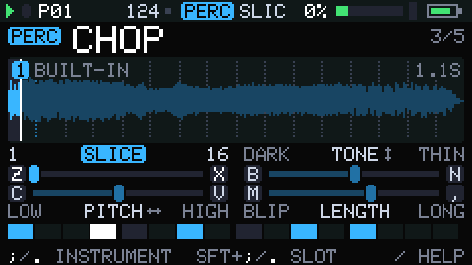

The PERC track can play a **sample** instead of its percussion sound: step its instrument (`9`, then `.`) past TAP, TRAIL and SHAKE to **CHOP**, **TAPE** or **STUTTER**. The picture becomes the sample's waveform: the part the next note plays is lit in the track colour, dotted lines mark the slices, a white line runs through it while it sounds. Top left: the slot number and the sample's name.

**Twelve slots.** The device keeps up to twelve samples (about 6 seconds each, mono). Each PERC track setting remembers which slot it plays (saved with the project); `shift`+`;` / `shift`+`.` on the instrument page choose the previous / next slot (`ctrl`+`z` takes a run of them back). An **empty slot plays a built-in sound** (three short sung phrases: OHYEAH, HEY and AHOO), and the page says `BUILT-IN`, so the instruments work before you have put anything in.

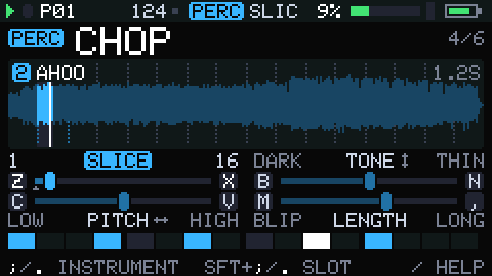

**The three instruments**

| Instrument | `z` `x` | `c` `v` | `b` `n` | `m` `,` |
|---|---|---|---|---|
| CHOP: the sample cut into 16 slices, each note picks one | SLICE (1 .. 16) | PITCH (two octaves down .. up) | TONE (dark .. open .. thin) | LENGTH (a blip .. the whole slice) |
| TAPE: the whole sample as tape | SPEED (backwards .. stopped .. normal .. double) | START (head .. tail) | WORN (clean .. crushed and dark) | ECHO (dry .. delay and reverb) |
| STUTTER: one chop repeated in time | RATE (1/4 .. 1/32) | RISE (each repeat lower .. higher) | SLICE (which of eight repeats; per note with a held step) | LENGTH (tight .. open) |

- **A slice per note (CHOP)**: hold a step and press `z` / `x`: that note gets its own SLICE (chapter 10, "note values"). A row of notes with different slices re-orders the sample.
- **Pitch**: on a sampler instrument the note keys play the sample at pitches: `z` is the sample as recorded, the others go up the project's scale. In STEP EDIT the note keys set the held note's pitch, `;` / `.` move it a semitone, `ctrl` an octave.
- **Length**: the note's gate (STEP EDIT, `s`: GATE) is how long the chop is held; then it fades with the instrument's release. STUTTER keeps repeating while the note fades, so a short note gives a short roll and a long one a long roll.
- **Tape stop (TAPE)**: tilt or move SPEED down while a long note plays and the tape slows, drops in pitch and stops; further down it runs backwards.

**Getting a sound in from the Mac**

*On the desktop app*: the folder `samples/` next to `projects/` holds one file per slot, named by the slot: `01-anything.wav` is slot 1, `12-...` slot 12. Copy WAV files in (any rate, mono or stereo, 16/24-bit or float): they are loaded when the app starts and again whenever a file changes. Or **drop a file on the window**: it goes into the slot of the selected track, replacing what was there (on a Mac any audio file macOS can read works). Files are converted to the slot's format (mono, 22,050 Hz, silence trimmed, at most about 6.2 s, levelled to -1 dBFS).

*On the device*: plug it in, **stop the sequencer**, and from the repository folder on the Mac:

```sh
tools/pg sample put 3 ~/Music/ohyeah.wav    # convert and put into slot 3 (1-12)
tools/pg sample list                       # what is in which slot
tools/pg sample get 3 back.wav             # a slot's audio back as a WAV
tools/pg sample rm 3                       # empty slot 3 (it plays its built-in sound again)
```

`put` converts the file on the Mac exactly as the desktop does (any WAV; on a Mac also AIFF, MP3, M4A and anything else `afconvert` reads) and names it after the file (`--name` to choose). The device shows `SAMPLE 3: 45%` while it writes, then `SAMPLE POOL UPDATED`; a sampler instrument plays the new sound from its next note. It refuses while the sequencer plays (writing the device's flash stops the audio for a moment). If a transfer is cut off, that slot is left empty (built-in sound), never half a sample: put it again.

### Recording with the microphone

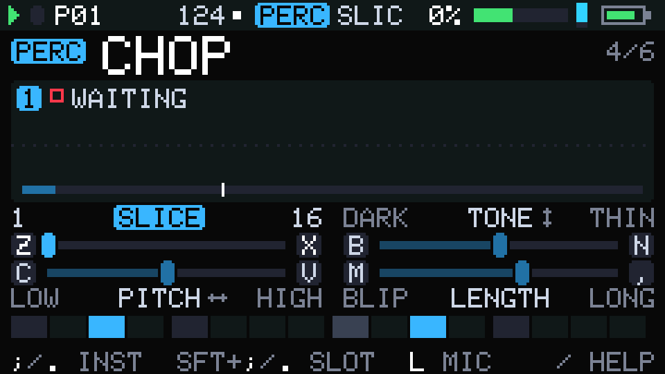

On CHOP, TAPE or STUTTER, **hold `l`** and make the sound into the device; **let go** when it is done. That is the sample the instrument plays, at once, in the slot the page shows.

- **It starts on the sound, not on the key.** While you hold `l` the page says `WAITING` and shows the level along the bottom, with a white tick where recording will start. The first sound above it starts the recording, with a short moment before it kept (40 ms), so the attack is not cut. The click of the key itself does not start it.
- **While it records** the page says `REC` and the time, and the sound appears across the picture as it comes in. The picture is the whole slot: when the wave reaches the right edge the slot is full (about 6 seconds) and it stops by itself.
- **Let go** and it is done: the picture is the new sample, the toast names it (`SLOT 3 REC03 1.6S`), and the next note plays it. The click of the key going up is left out. If no sound came, `NO SOUND` and nothing changes.
- **Its level is made right for you**: a quiet recording plays as loud as a loud one (up to +24 dB; a slot's recording is kept as it came in, and the level is set when it plays).
- **A slot that holds a sample asks first** (`REPLACE SLOT 3?`): `enter` erases it, then hold `l` again to record. There is no undo. `shift`+`;` / `.` to another slot first if you want to keep it.
- **`ERASING`**: a slot that is empty but was not left clean (a `tools/pg sample put` that was cut off) is erased before it can record. That takes a second or two, the sound fades out meanwhile and the groove pauses, then it carries on (and if you are still holding `l` it starts listening).

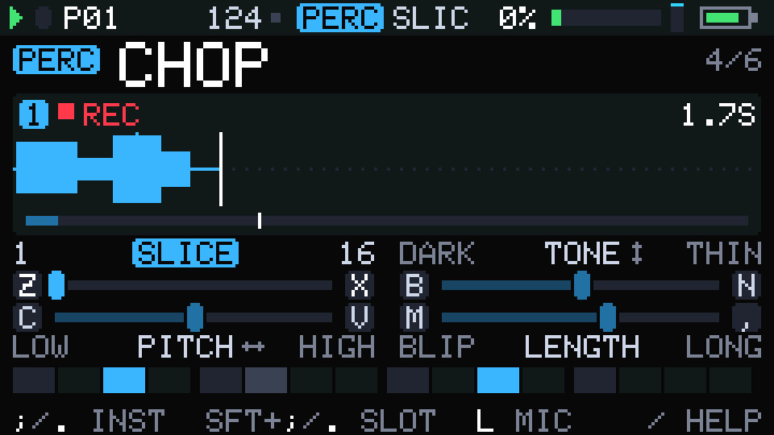

**With the groove playing.** You can record while the transport runs, and nothing stops: sing along to the groove in headphones, let go, and the next note plays what you sang. **The microphone also hears the built-in speaker**, so without headphones the recording picks up the groove too. Use headphones, or stop the transport, when you want only your voice. (The very first `l` after switching on fades the sound out and back in for a moment while the microphone wakes up.)

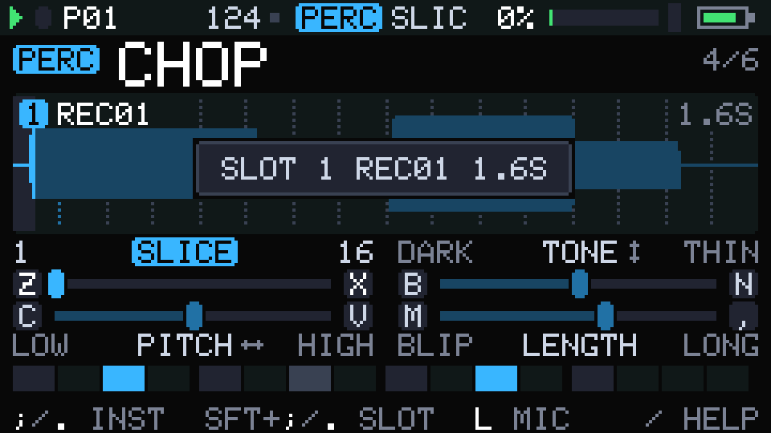

On the **desktop app** the same gesture records from the Mac's microphone (DESKTOP.md "Recording a sample"); the recording is the file `samples/NN-recNN.wav` there.

If recording does not work on the device, type `r` in the serial monitor and paste the `[mic]` lines (chapter 16): they say whether the microphone came alive, its level, and what happened to the last recording.

### Resampling: record what you hear

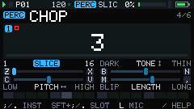

**`shift`+`l`** on CHOP, TAPE or STUTTER records what the Pocket Groove itself is playing into the slot: the whole mix as you hear it, with the effects, the ducking and the DJ filter. No microphone is involved, so nothing from the room gets in.

1. **Choose what to record.** Solo what you want (`fn` + its note key, chapter 11), or mute the rest. To resample the lead: `fn`+`,`.
2. **Go to CHOP's page** (or TAPE's, STUTTER's) and choose the slot (`shift`+`;` / `.`).
3. **Hold `shift`+`l`** while the groove plays. You can let go of `shift`; keep `l` down. The box counts the beats to the next bar line (`4 3 2 1`), and recording starts exactly on it.
4. **Let go of `l`** after the last bar you want. Recording carries on to the end of that bar and stops on the bar line. The toast names the new sample (`SLOT 3 RES03 3.9S`).

The sample is **whole bars**, from a bar line to a bar line. In CHOP, one resampled bar gives one slice per sixteenth step: slice 1 is step 1, slice 5 is step 5, and so on. Give each note its own SLICE and the bar plays back in a new order. Bar lines are steps 1, 17, 33 and 49 of the playing pattern, and its end.

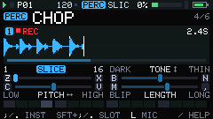

- **Hold it and it fills the slot.** The slot holds about 6.2 seconds. If you keep holding, recording stops on the last bar line that still fits. At 60 BPM one bar is 4 seconds; from about 78 BPM two bars fit.
- **The track you are on does not record itself.** While its slot records, CHOP (or TAPE, STUTTER) on that slot plays nothing. After recording it plays the new sample. Other slots and the other tracks play and are recorded.
- **With the transport stopped** there is no bar to wait for. The page says `WAITING` and recording starts on the first sound, for example a pad or a note you play. To play the lead by hand, keep `l` held, go to GROOVE (`` ` ``), select the lead (`shift`+`k`) and play. Let go of `l` to stop. Nothing is trimmed.
- **Stop while it records**, and the sample ends on the last bar line it passed.
- **The level** is set the same way as for the microphone: the loudest point plays just under full scale.
- **The same rules as the microphone**: a slot that holds a sample asks first (`REPLACE SLOT 3?`), and there is no undo. The device needs the 44.1 kHz setting (`RESAMPLE: 44.1K ONLY` at 32 kHz).

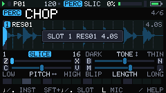

On the **desktop app** the same gesture works with no microphone at all. The sample becomes the file `samples/NN-resNN.wav` (DESKTOP.md "Resampling").

**What is where.** The samples live in a part of the device's flash that projects never use: saving, loading and pushing projects never touches them, and a project only remembers the slot number. A project made with a sample sounds different on a device that has another sample in that slot. While a recording runs, the device does not save projects (`RECORDING: SAVE AFTER`) and `tools/pg` transfers that write wait (`ERR RECORDING`).

